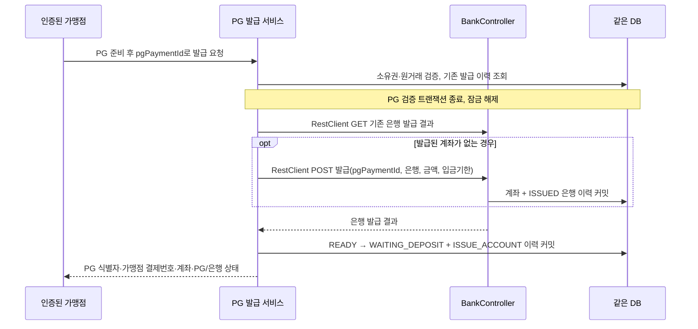

# 가맹점 PG 거래 기반 가상계좌 발급

2026-11-08 PG 거래를 은행의 실제 발급 결과에 연결했다. 이 단계는 **PG 측 발급 연동**이며 Ticksy 호출 전환, 신규 거래의 입금·취소·환불·만료·결과 통보는 후속 작업이다.

## 호출과 책임



- `GatewayVirtualAccountController`: 가맹점 principal과 요청/응답 처리.
- `GatewayVirtualAccountIssuanceService`: HTTP 전후 처리 조정. 트랜잭션 안에서 호출할 수 없는 `Propagation.NEVER`다.
- `GatewayVirtualAccountIssueCommandService`: 짧은 PG 트랜잭션에서 인증 정보·거래 소유권·저장된 결제수단·예매자·금액·은행을 검증하고 PG 상태/이력을 확정한다.
- `FinancialSimulationGatewayService`: 등록된 서버 설정의 내부 주소로 RestClient 호출. 요청에서 주소를 받지 않는다.
- `BankController` → `BankVirtualAccountIssuanceService` / `BankVirtualAccountIssueCommandService`: PG 식별자로 발급을 멱등 처리하고 번호 생성·계좌·은행 이력만 담당한다. 새 은행 발급 경로는 Ticksy API, 공연일, 가맹점 결제번호를 참조하지 않는다.

## 외부 API

먼저 기존 `POST /api/v1/payments/gateway/prepare`로 `BANK_TRANSFER` 거래를 준비한다. 가맹점이 결정한 일반적인 `expiresAt`과 `bankCompany`를 함께 저장한다. Ticksy 공연일 기반 기한 계산은 향후 Ticksy 전환 시 가맹점 측에 둔다.

```http
POST /api/v1/payments/virtual-account/gateway/{pgPaymentId}/issue
X-Service-Token: {등록된 가맹점 자격증명}
Content-Type: application/json
```

```json
{
  "buyerReference": "buyer-1",
  "amount": 10000,
  "bankCompany": "KB"
}
```

선택 필드 `merchantId`는 인증된 가맹점 코드와의 일치 검증에만 사용한다. 사용자 JWT나 입금 제공자 토큰으로 이 API를 호출할 수 없다. `buyerReference`는 준비 시 가맹점이 확인한 사용자 참조값과 비교한다. 최종 사용자 인증은 가맹점 책임이며 기존 사용자 JWT 기반 카드 API는 변경하지 않았다.

200 응답 예시:

```json
{
  "pgPaymentId": "20261108550e8400-e29b-41d4-a716-446655440000",
  "merchantId": 1,
  "paymentNo": "PAY-1",
  "buyerReference": "buyer-1",
  "bankCompany": "KB",
  "bankName": "KB국민은행",
  "accountNumber": "1111-1234-123456",
  "amount": 10000.00,
  "expiresAt": "2026-11-09T23:59:59",
  "pgStatus": "WAITING_DEPOSIT",
  "bankStatus": "WAITING_DEPOSIT"
}
```

`pgStatus`는 현재 PG 거래 상태다. `bankStatus`와 계좌 정보는 최초 성공 발급의 스냅샷이며 가맹점 통보 완료를 의미하지 않는다. 최신 PG 거래 조회에는 기존 가맹점 범위의 `GET /api/v1/payments/gateway/{pgPaymentId}`를 사용한다.

| 상황 | 결과 |
| --- | --- |
| 인증 누락/잘못된 자격증명 | 401 |
| 본문의 가맹점 코드가 principal과 다름, 신규 실행 시 가맹점 정지 | 403 |
| 없는 PG 거래 또는 다른 가맹점 거래 | 동일한 404 |
| 저장된 카드 거래에 계좌 요청, 다른 금액·예매자·은행 | 409 `GATEWAY_PAYMENT_REQUEST_MISMATCH` |
| 잘못된 입력/PG ID, 미발급 거래의 입금기한 만료 | 400 |
| 금융 통신 실패, 확인 불가능하거나 원거래와 다른 은행 결과 | 503 `FINANCIAL_PROVIDER_UNAVAILABLE` |
| PG 상태/이력 저장 실패 | 503 `GATEWAY_STORAGE_UNAVAILABLE` |

정지/기한 만료는 **새 금융 실행**을 제한한다. 이미 발급된 은행 결과의 복구와 저장된 성공 응답의 재전송은 허용한다. 금융 결과 확인 실패를 PG 실패·취소로 기록하지 않는다.

## 은행 API와 식별자

내부 토큰 `X-PG-Simulation-Token`으로만 접근한다.

| 메서드/경로 | 역할 |
| --- | --- |
| POST `/internal/financial-simulations/banks/virtual-accounts/gateway/issue` | `{pgPaymentId, bankCompany, amount, expiresAt}`로 발급/동일 요청 재응답 |
| GET `/internal/financial-simulations/banks/virtual-accounts/gateway/{pgPaymentId}` | 발급 결과 조회, 미발급 404 |

가맹점 결제번호는 `gateway_payments`의 `(merchant_id, merchant_payment_no)`로만 매핑한다. 새 계좌의 `pg_payment_id`는 PG 거래 FK이며 UNIQUE다. 기존 은행 `payment_no` 컬럼은 NOT NULL/UNIQUE이므로 새 경로에서는 **그 값도 pgPaymentId로 채운다**. 은행 이력의 결제번호 스냅샷도 이 내부 식별자를 사용한다. 가맹점 원래 번호를 복사하지 않아 서로 다른 가맹점의 동일 결제번호가 충돌하지 않는다. 별도 매핑 테이블은 없다.

PG는 UUID를 포함하는 String 식별자를 정규화하며 기존 36자 ID도 지원한다. 은행 재시도는 같은 PG ID를 사용한다. 같은 ID로 은행·금액·입금기한이 바뀌면 은행도 거절한다. 금액은 숫자값으로 비교하고 DB 정밀도에 맞게 소수 두 자리, 기한은 마이크로초로 정규화한다.

## 멱등성과 트랜잭션

1. PG 원거래 검증/행 잠금은 별도 짧은 트랜잭션에서 끝낸다. HTTP 중 PG 잠금과 DB 트랜잭션을 유지하지 않는다.
2. 은행은 `pg_payment_id` UNIQUE로 계좌를 한 개만 저장한다. 계좌와 `ISSUED` 이력은 같은 금융 트랜잭션이다. 동시 최초 발급의 유니크 충돌은 해당 트랜잭션이 롤백된 후 새 트랜잭션으로 먼저 커밋된 결과를 조회해 재응답한다.
3. PG는 원거래를 잠그고 은행의 ID·은행·은행명·금액·기한·계좌·상태를 대조한다. `WAITING_DEPOSIT` 변경과 `ISSUE_ACCOUNT / INITIAL` 이력은 한 PG 트랜잭션이다. 이력에는 계좌번호·은행명·은행 발급 상태를 저장한다.
4. 완료된 동일 요청은 저장된 이력에서 응답한다. 은행이 응답하지 않아도 계좌를 다시 만들지 않는다. 같은 식별자의 다른 금액 등은 재응답 전에 거절한다.
5. 은행 커밋 뒤 HTTP 응답이 유실되거나 PG 상태/이력 저장이 실패하면 PG는 READY로 남을 수 있다. 같은 요청의 다음 재시도에서 은행 GET으로 기존 계좌를 확인하고 PG 결과만 확정한다. 자동 주기 복구는 이 단계에 포함하지 않는다.

HTTP를 가로지르는 전체 원자성은 없다. 은행 성공과 PG 성공 사이의 일시적 차이를 조회/재시도로 복구한다. 발급 응답을 위한 내부 Outbox는 추가하지 않았다. 기존 Ticksy와의 서비스 경계 Outbox는 유지한다.

## 호환성과 DB

- 기존 Ticksy와 프런트의 URL·DTO·카드 인증·가상계좌 발급·입금 전 취소·입금 경합·환불·Outbox 계약을 유지한다. 이번 단계에서 Ticksy가 새 prepare/issue API를 호출하거나 PG ID를 저장하도록 바꾸지 않았다.
- 기존 은행 처리의 결제번호 조회·잠금·계좌번호 입금·만료 스케줄러는 `pg_payment_id IS NULL`인 기존 거래만 처리한다. 새 연결 계좌를 Ticksy 고정 검증/통보 경로로 처리하거나 다른 가맹점 거래를 취소할 수 없다.
- **새 경로의 연결 계좌는 발급/재응답/PG 상태 조회만 가능하다. 입금·취소·환불·자동 만료·결과 통보는 아직 연결하지 않았다.** 가맹점 기준 처리와 통보를 구현한 뒤 Ticksy의 실제 발급 경로를 전환한다. 기존 데이터를 PG에 일괄 연결하는 이관도 그 뒤에 수행해야 한다.
- 기존 VARCHAR(44) FK/UNIQUE, PG 작업 이력 유니크, 은행 결제번호 VARCHAR(60) 정의를 사용하므로 이번 단계는 `schema.sql` 변경이나 새 마이그레이션이 필요 없다. 실제 DB 테이블을 삭제·재생성하지 않는다.

## 검증

`GatewayVirtualAccountIssuanceIntegrationTest`는 외부 MockMvc 인증 → 실제 임의 포트 RestClient → 내부 금융 인증 → 은행 DB 트랜잭션을 실행한다. 격리 H2에서 서로 다른 가맹점의 같은 결제번호, 가맹점/예매자/수단/은행/금액 검증, 중복·동시 발급, 정지/만료 정책, 은행 이력 실패 롤백, PG 이력 실패 후 복구, 은행 응답 유실, 변조된 은행 결과 거절, 기존 API 격리를 검증한다.

`GatewayCorePostgresTest`는 실제 PostgreSQL에서 DDL validate와 테스트별 롤백만 사용한다. 발급 상태와 JSON 결과 이력, PG FK 연결, 기존 범위 조회의 연결 거래 제외를 확인한다.

2026-11-08 아래 범위에서 `BUILD SUCCESSFUL`을 확인했다. 실제 DB 연결 환경변수 `GATEWAY_CORE_VERIFY_URL/USER/PASSWORD`를 설정하고, 기존 임시 DB 전용 변수 `GATEWAY_TEST_POSTGRES_PORT`, `GATEWAY_DEPOSIT_TEST_POSTGRES_PORT`는 설정하지 않았다. 최초 실행에서 중지된 DB로 연결에 실패한 뒤 기존 `local-postgres` 컨테이너를 시작하고 전체 범위를 다시 실행한 최종 결과다.

```powershell
.\gradlew.bat -g D:\.gradle :payment-gateway-service:test `
  --tests '*.service.*' --tests '*.security.*' --tests '*.config.*' --tests '*.jpa.gateway.*' `
  --offline --no-daemon --console=plain
```

| 실행 범위 | 테스트 | 실패/오류/건너뜀 |
| --- | --- | --- |
| PG 선택 범위 전체, 22개 클래스 | 189 | 각 0 |
| 위 범위 중 신규 PG 계좌 발급 통합 | 16 | 각 0 |
| 위 범위 중 기존 금융 HTTP 통합 | 13 | 각 0 |
| 위 범위 중 실제 PostgreSQL 검증 | 13 | 각 0 |

기존 카드·입금/취소 경합·Outbox·스케줄러·환불 회귀를 포함한다. 실제 DB는 public 테이블 55개와 가맹점 1건이 유지됐다. PG 거래/이력, 은행 계좌/이력, 카드 승인, 입금/만료 Outbox는 검증 후 모두 0건이며 DDL 변경이나 테이블 삭제·초기화는 하지 않았다. `git diff --check`도 통과했다.
