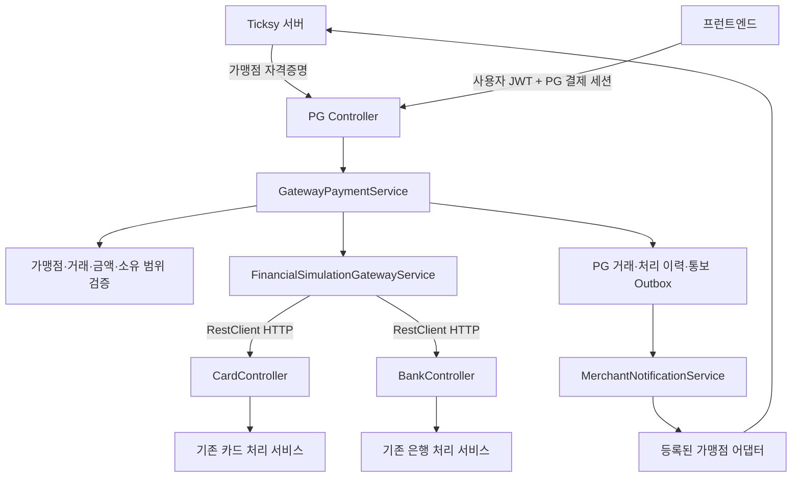
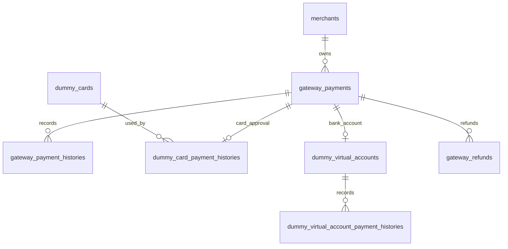

#> 2026-11-18 모델 정리: 구형 PG 환불·은행 Outbox 테이블, 미사용 DTO와 Ticksy 구형 카드 콜백도 제거했다. 아래 이전 설계·호환 경로 설명보다 [현재 정리 범위](payment-legacy-model-cleanup.md)와 [환불 멱등성](refund-idempotency.md)을 우선한다.

 PG 가맹점·거래·식별자 설계

2026-11-15 Ticksy 신규 카드 checkout의 PG prepare·ID 저장과 브라우저의 거래 전용 세션 승인·조회, 공통 결과 통보를 연결했다. 실제 호출·인증·응답 유실 복구·기존 카드 호환 및 현재 수단 전환/환불 제한은 [카드 checkout 연동](ticksy-gateway-card-checkout.md)을 우선한다.

2026-11-13 신규 PG 연결 가상계좌의 입금 후 전액·부분 환불과 명시적 신청 철회를 구현했다. Ticksy→PG는 1회, PG→은행은 최대 4회이며 신청 스냅샷과 같은 키로 재요청한다. 새 API·NOWAIT 잠금·스키마·기존 경로의 호환성 범위는 [환불·신청 철회 계약](payment-gateway-bank-refund.md)을 우선한다. 아래 초기 설계의 환불 후속 작업 설명은 이 문서의 현재 구현으로 대체한다.

2026-11-10 최신 변경: 은행 입금은 은행→PG와 PG→가맹점의 독립 Outbox, PG ID 취소는 비동기 접수→은행 요청 Outbox→가맹점 결과 Outbox로 변경했다. 취소 경로의 입금 복구 호출과 PG의 은행 원장 직접 대사를 제거했다. 아래 초기 단계 설명보다 [입금 문서](payment-gateway-account-deposit.md)와 [취소 문서](payment-gateway-account-cancellation.md)의 현재 계약을 우선한다.

작성일: 2026-11-04. 현재 구현 분석은 [사전 분석](payment-gateway-refactoring-analysis.md)을 따른다.

이 문서는 전체 구현의 기준 설계다. [핵심 테이블 DDL 초안](design/payment-gateway-core-schema.sql)은 설계 기록으로 유지한다. 가맹점·PG 거래 모델과 서버 인증·준비/조회 API는 구현했으며, 실제 적용 범위와 SQL은 [기반 구현 문서](payment-gateway-core-implementation.md)를 따른다. 금융 연결·카드 세션·통보 책임 분리는 아래 설계에 따른 후속 작업이다.

2026-11-06 사용자 요청으로 은행·카드의 호출 경계를 내부 메서드에서 RestClient HTTP로 변경했다. 같은 앱/DB는 유지한다. 현재 외부 금융 API의 실제 경로와 응답·트랜잭션 계약은 [모의 금융 HTTP 구현](payment-gateway-financial-http.md)을 따른다. HTTP 전후를 하나의 로컬 트랜잭션으로 묶지 않는다. 2026-11-08 [PG 거래 기반 계좌 발급](payment-gateway-account-issuance.md)과 [PG 카드 승인](payment-gateway-card-approval.md)을 구현했다. 2026-11-09 신규 은행 연결 거래의 [입금·가맹점 통보·응답 유실 복구](payment-gateway-account-deposit.md)도 연결했다. 2026-11-10 [PG 거래 기반 입금 전 취소](payment-gateway-account-cancellation.md)도 연결했다. 만료·가상계좌 환불은 각각의 후속 구현 문서를 따른다.

## 1. 결정한 구조

프런트엔드와 Ticksy 모두 PG의 외부 진입점을 사용할 수 있다. 기존 금융 API 컨트롤러는 인증된 요청을 `FinancialSimulationGatewayService`에 전달하고, RestClient가 모의 은행·카드 컨트롤러를 실제 HTTP로 호출한다. 모의 컨트롤러가 기존 금융 서비스를 주입한다. 은행·카드는 같은 PG 애플리케이션과 DB를 사용하되 HTTP 요청별 트랜잭션은 독립적이다.

아래 도식은 가맹점별 실제 금융 연결 이후의 목표까지 포함한다. 현재 신규 준비/조회는 로컬 PG 서비스가 처리하고, 기존 카드·가상계좌 외부 API는 HTTP 중계 서비스로 연결한다.



- 가맹점 코드(`merchantId`): PG를 이용하는 업체의 숫자 키. 최초 가맹점은 Ticksy다.
- `cardCompany`, `bankCompany`: 금융 서비스 구현체를 선택하는 코드다. 가맹점 코드와 독립적이다.
- 모의 은행·카드 컨트롤러가 금융 처리 서비스를 DI로 주입받는다. 금융사별 공통 로직 분리는 이 HTTP 진입점 뒤에서 수행한다.
- 카드/은행별 모의 컨트롤러를 두고 현재 금융사 enum은 기존 요청으로 전달한다. 입금 제공자용 외부 진입점도 유지한다.
- 공통 금융 서비스는 PG 요청 DTO, 사용자 인증 principal, Ticksy Feign Client, 가맹점 통보 Outbox를 참조하지 않는다. 금융 입력·결과 객체와 원장·금융 거래·이력만 다룬다.
- 은행/카드 처리 후 PG 상태와 통보 Outbox를 갱신하는 책임은 PG 계층에 둔다. HTTP 결과 확정은 별도 PG 트랜잭션으로 처리하고 응답 유실은 같은 식별자로 조회/복구한다. 초기 HTTP 변경에서는 은행↔PG Outbox를 추가하지 않았으나, 현재 은행 입금과 PG 취소 요청은 명시적 Outbox를 사용한다. 카드 HTTP 경계는 기존대로 유지한다.

### 패키지와 클래스

2026-11-14 실제 컨트롤러는 controller.gateway.payment·refund·deposit·expiration과 controller.financial로 분류한다. 아래 목록은 초기 설계이며 현재 경로는 [컨트롤러 패키지 문서](payment-gateway-financial-http.md#컨트롤러-패키지)를 따른다.

기존 `controller`, `service`, `jpa`, `dto` 규칙을 유지한다. 아래는 도입할 클래스의 위치이며 현재 존재하는 클래스 목록이 아니다.

```text
controller/
  gateway/GatewayPaymentController
  card/GatewayCardPaymentController             # 기존 경로 호환 진입점
  virtualAccount/GatewayVirtualAccountController
  simulation/CardController                    # 내부 인증을 거치는 실제 HTTP 진입점
  simulation/BankController
  bank/BankDepositController                   # 기존 deposit 경로를 인계
service/
  merchant/MerchantAuthenticationService
  gateway/GatewayPaymentService                # HTTP 검증·통보를 조정, 전체 TX 없음
  gateway/GatewayPaymentCommandService         # PG 준비·이력 로컬 TX, 금융 HTTP와 분리
  gateway/FinancialSimulationGatewayService    # TX 밖에서 RestClient HTTP 호출
  gateway/GatewayRefundRegistrationService     # 원거래 잠금 전 최초 환불 요청 보존
  gateway/GatewayPaymentSessionService
  gateway/notification/MerchantNotificationService
  gateway/notification/ticksy/TicksyMerchantAdapter
  card/CardPaymentProcessor
  card/CardPaymentRouter
  card/CommonCardPaymentService
  card/provider/ShinhanCardPaymentService       # 지원 카드사별 구현체
  bank/BankPaymentProcessor
  bank/BankPaymentRouter
  bank/CommonBankPaymentService
  bank/provider/KbBankPaymentService            # 지원 은행별 구현체
jpa/
  merchant/Merchant
  gateway/GatewayPayment
  gateway/GatewayPaymentHistory
  card/                                        # 기존 원장·원승인 연결 유지
  virtualAccount/                              # 기존 계좌·이력 연결 유지
  refund/                                      # 가맹점 범위의 환불 요청
  outbox/                                      # PG가 소유하는 서비스 간 전달 기록
```

라우터는 Spring이 주입한 구현체 목록으로 코드별 Map을 구성한다. 지원 코드 중복은 시작 시 실패시키고, 지원하지 않는 코드는 금융 변경 전에 거절한다. 공통 enum에 있는 간편결제 수단은 이번 구현에서 지원하지 않는다. 카드/은행 인터페이스에 불필요한 공통 상속은 도입하지 않는다.

개념적인 메서드 계약은 다음과 같다. 금융 엔티티·잠금 획득과 이력 저장은 공통 금융 서비스가 수행한다.

```java
// PG가 요청 시점의 선택과 저장된 거래 정보를 검증한 뒤 호출한다.
CardApprovalResult approve(CardApprovalCommand command);
CardCancellationResult cancelApproval(CardCancellationCommand command);
CardRefundResult refund(CardRefundCommand command);

BankAccountIssueResult issue(BankAccountIssueCommand command);
BankDepositResult deposit(BankDepositCommand command);
BankCancellationResult cancel(BankCancellationCommand command);
BankExpirationResult expire(BankExpirationCommand command);
BankRefundResult refund(BankRefundCommand command);
```

각 command에는 PG 거래 ID와 금융 처리에 필요한 값만 넣는다. 은행 발급 command에는 `depositDeadline`을 넣고 공연일은 전달하지 않는다. 금융 결과에 merchant 통보 완료 여부를 넣지 않는다.

## 2. 식별자

| 식별자 | 형식·발급 주체 | 의미와 범위 |
| --- | --- | --- |
| `merchant_id` | BIGINT / PG DB | 가맹점 PK이자 공개 숫자 가맹점 코드. 인증 결과의 소유 범위이며 비밀값이 아님 |
| `pg_payment_id` | VARCHAR(44) / PG | 최초 저장 시 한국 날짜의 yyyyMMdd + UUID로 생성하는 공통 PG 거래 PK. 자바 String으로 저장하며 기존 36자 UUID도 보존 |
| `merchant_payment_no` | VARCHAR(60) / 가맹점 | Ticksy의 기존 `paymentNo`. merchant 안에서만 유니크 |
| 카드 `transaction_id` | 기존 CARD-UUID / 카드 도메인 | 원승인 거래번호. PG 거래 ID와 구분 |
| `gateway_refund_id` | UUID / PG | PG 환불 기록 PK |
| `merchant_refund_request_id` | VARCHAR(64) / 가맹점 | Ticksy의 기존 `paymentRefundProcessId`를 문자열로 정규화한 값 |
| `event_id` | UUID / PG | 커밋된 통보 이벤트의 ID. 재전달에도 유지 |

필수 유니크는 `(merchant_id, merchant_payment_no)`와 `(merchant_id, merchant_refund_request_id)`다. 같은 가맹점의 환불 ID를 다른 결제에 재사용해도 거절한다. 다른 가맹점은 같은 paymentNo와 환불 ID를 사용할 수 있다. PG ID를 안다는 사실은 접근 권한을 부여하지 않는다.

JSON의 기존 `paymentNo`, `transactionId`, `paymentRefundProcessId` 이름은 초기 호환 DTO에서 유지한다. `paymentNo`를 PG ID로 바꾸지 않고 `pgPaymentId`를 별도로 추가한다. 신규 공통 환불 API의 요청 ID는 문자열이며 Ticksy 호환 API는 기존 Long 값을 변환한다. 두 필드를 함께 받는 경우 서로 다른 값을 허용하지 않는다.

## 3. 핵심 테이블

### merchants / Merchant

| 컬럼 | 형식·조건 | 책임 |
| --- | --- | --- |
| `merchant_id` | BIGSERIAL PK, 양수 | 숫자 가맹점 코드. 등록 후 변경·재사용하지 않음 |
| `merchant_name` | VARCHAR(100), NOT NULL, 중복 허용 | 가맹점 표시 이름. 식별·인증 기준으로 사용하지 않음 |
| `status` | ACTIVE / SUSPENDED | 신규 처리 허용 정책 |
| `credential_hash` | VARCHAR(64), nullable, UNIQUE | 발급 키의 SHA-256 해시. NULL은 미발급·폐기 |
| `notification_contract` | VARCHAR(40), NOT NULL | 통보 DTO 필드 구성·응답 규칙의 계약 버전 코드. 현재 CARD_NOTIFICATION_V1 지원 |
| `notification_target_key` | VARCHAR(100), NOT NULL | merchant_id와 함께 merchant_notification_endpoints의 등록 대상 참조 |
| `created_at`, `updated_at` | TIMESTAMP(6) | 생성·수정 시각 |

`merchants` 자체가 숫자 코드와 가맹점명을 매핑한다. 별도의 가맹점 코드 매핑 테이블이나 문자열 `merchant_code` 컬럼은 추가하지 않는다. 예시는 다음과 같다.

| merchant_id (가맹점 코드) | merchant_name |
| --- | --- |
| 1 | Ticksy |
| 2 | Melon |
| 3 | Ticksy |

1번과 3번은 이름이 같아도 서로 다른 가맹점이다. 이름을 변경해도 코드는 유지한다. JSON과 인증 컨텍스트는 `merchantId` 하나로 이 숫자를 표현한다. 예시 번호를 서비스 분기 조건으로 하드코딩하지 않고, 실제 등록된 행과 자격증명·통보 설정으로 연결한다. 기존 초안의 merchant_name에도 유니크 제약은 없었으며, 이번 변경은 숫자 PK를 가맹점 코드로 통일하는 결정이다.

가맹점 원문 인증 키·사용자 JWT·카드 원문은 저장하지 않는다. Merchant에는 SHA-256 credential_hash만 저장하며 미발급·폐기는 NULL로 표현한다. Merchant 숫자 코드와 credentialKey 헤더로 인증하고, 가맹점별 YAML 토큰 목록은 사용하지 않는다. 한 가맹점은 현재 키 하나만 사용하며 교체 시 이전 키는 무효화된다. 상세 발급·전환 절차는 [DB 가맹점 인증](payment-gateway-merchant-authentication.md)을 따른다.

SUSPENDED는 준비·승인·발급·수단 전환을 차단한다. 기존 거래 조회·취소·환불은 같은 가맹점 인증과 소유 검증 후 허용한다. 이미 발급된 계좌의 입금 사실 수신, 기한 만료, 통보 재시도도 계속 처리한다. 가맹점을 일시 중단했다고 기존 금융 사실을 누락시키지 않는다. 가맹점과 거래는 물리 삭제하지 않는다.

### gateway_payments / GatewayPayment

| 컬럼 | 형식·조건 | 책임 |
| --- | --- | --- |
| `pg_payment_id` | VARCHAR(44) PK | yyyyMMdd + UUID 문자열로 내부 거래 연결·API 결과 식별 |
| `merchant_id` | BIGINT NOT NULL FK | 소유 가맹점 |
| `merchant_payment_no` | VARCHAR(60) NOT NULL | 가맹점 결제번호 |
| `buyer_reference` | VARCHAR(50) NOT NULL | 가맹점이 인증해 전달한 예매자 ID |
| `payment_method` | CREDIT_CARD / BANK_TRANSFER | 현재 저장된 결제수단 |
| `card_company`, `bank_company` | VARCHAR(30), 조건부 NULL | 최초 승인/발급 시 확정한 금융사 |
| `amount` | NUMERIC(15,2), 양수 | 최초 확정 금액, 변경 불가 |
| `refunded_amount` | NUMERIC(15,2), 기본 0 | 실제 성공 환불 누적액 |
| `status` | PG 상태 enum | 금융 처리와 취소·만료의 결과 |
| `creation_request_hash` | CHAR(64) NOT NULL | 최초 준비 요청의 정규화된 불변 내용 해시 |
| `method_revision` | INTEGER, 기본 0 | 명시적 수단 전환 때만 증가 |
| `expires_at` | TIMESTAMP(6) NOT NULL | 현재 수단의 승인/입금 기한 |
| `paid_at`, `cancelled_at` | TIMESTAMP(6), NULL 가능 | 최초 금융 완료·취소 시각 |
| `version` | BIGINT, 기본 0 | JPA @Version, 지연된 결과 덮어쓰기 방지 |
| `created_at`, `updated_at` | TIMESTAMP(6) | 생성·수정 시각 |

`UNIQUE(merchant_id, merchant_payment_no)`가 번호 매핑 자체다. 매핑 전용 테이블은 만들지 않는다. Outbox·환불의 가맹점 스냅샷 FK를 검증하기 위해 `(pg_payment_id, merchant_id)`에도 유니크를 둔다.

현재 지원 통화는 KRW다. 금액은 기존 금융 도메인의 BigDecimal/NUMERIC(15,2)를 유지하고, Ticksy 어댑터는 기존 정수 금액과 정확하게 대조한다. scale 2를 초과한 실질 소수는 저장 전 거절한다. 입력의 금액 표현 차이는 해시에 영향을 주지 않도록 2자리로 정규화한다.

최초 해시는 가맹점 결제번호·예매자·최초 수단·금액·기한·발급 시 은행의 고정 필드로 만든다. 카드번호·CVC·비밀번호·세션 토큰·통보 URL을 포함하거나 보존하지 않는다. 같은 키의 준비 재요청은 최초 해시를 비교하고 현재 거래 결과를 반환한다. 현재 수단은 변경될 수 있으므로 최초 수단을 현재 수단으로 대체해 해시를 다시 계산하지 않는다.

### gateway_payment_histories / GatewayPaymentHistory

PG의 성공한 업무 처리와 상태 전이를 append-only로 저장한다. 핵심 필드는 `history_id`, `pg_payment_id`, `operation_type`, `operation_key`, `before_status`, `after_status`, `amount`, `request_hash`, `details`, `occurred_at`이다. `UNIQUE(pg_payment_id, operation_type, operation_key)`를 둔다.

`details`는 명시한 필드만 저장하는 JSONB다. 예: 계좌 발급 결과, 수단 전환의 은행·고정 기한, 보상 취소 사유, 환불 ID. 카드 원문·인증 토큰은 기록하지 않는다. 실패 시도·전달 재시도는 성공 이력을 중복 생성하지 않고 기존 실패 기록/Outbox 시도 정보에서 관리한다. 이력 테이블은 번호 매핑이나 미완료 환불 등록을 대신하지 않는다.

## 4. 금융 모델 연결

2026-11-05 모델/스키마 연결 단계에서는 두 금융 테이블에 nullable PG 식별자와 FK/유니크 제약, 식별자를 받는 생성 메서드 및 내부 조회를 추가했다. 사용자 요청에 따라 PG ID는 한국 날짜의 yyyyMMdd + UUID로 생성하고 자바 String / DB VARCHAR(44)로 통일했다. 기존 API와 데이터의 전환이 남아 있으므로 아래 NOT NULL 및 조회 범위 변경은 최종 목표다. 실제 적용 범위는 [금융 거래 연결 문서](payment-gateway-financial-links.md)를 참고한다.



- 기존 `dummy_cards`는 카드 원장으로 유지한다. 여기에 특정 PG 거래 FK를 두지 않는다.
- 기존 `DummyCardPaymentHistory`는 실질적으로 원승인 거래 행이다. 초기 구현에서는 테이블/클래스 이름을 유지하고 `pg_payment_id UNIQUE NOT NULL FK`를 추가한다. 금융 상태에서 TICKET_PAYMENT_*를 분리한다. 카드 승인·취소·환불의 상세 이력은 append-only 금융 이력으로 남긴다.
- 기존 `dummy_virtual_accounts`에도 `pg_payment_id UNIQUE NOT NULL FK`를 추가한다. 계좌번호의 전역 유니크는 유지한다. 은행 이력은 원계좌 FK를 통해 PG 거래에 연결된다.
- 두 금융 테이블의 `payment_no`는 이행 중 원번호 스냅샷으로 보존할 수 있지만, 단독 유니크·운영 조회 기준에서 제외한다. 금융 처리 조회는 PG 거래 ID를 사용한다.
- 한 PG 거래의 금융수단은 PG 상태/잠금 아래에서 하나만 확정한다. 승인 거래가 생긴 뒤 다른 수단의 계좌를 만들 수 없다. 서로 다른 금융 테이블에 대한 이 규칙은 서비스 트랜잭션과 회귀 테스트로 검증한다.
- 은행의 입금 사실은 `deposited_at`, 최초 입금자, 금액·입금 이력으로 보존한다. `hasDeposit()`은 현재 상태가 아니라 최초 입금 사실을 기준으로 바꾼다. CANCELLED는 실제 반환을 의미하지 않는다.

## 5. 상태와 멱등성

### PG 상태

| 전이 | 조건 |
| --- | --- |
| 생성 → READY | 인증된 merchant 요청의 번호·금액·예매자·기한 고정 |
| READY → WAITING_DEPOSIT | 은행 계좌 발급 성공 |
| READY → PAID | 카드 승인·사용액 반영 성공 |
| WAITING_DEPOSIT → PAID | 최초 유효 입금 반영 |
| PAID → PARTIALLY_REFUNDED → REFUNDED | 성공한 환불 누적액 반영. 전액 환불은 PAID → REFUNDED도 허용 |
| READY / WAITING_DEPOSIT / EXPIRED → CANCELLED | 원거래/계좌를 검증한 취소. EXPIRED 취소는 기존 계좌 취소 계약 보존 |
| PAID → CANCELLED | 확정적인 카드 보상 취소 또는 Ticksy 예매 취소 수렴 |
| READY / WAITING_DEPOSIT → EXPIRED | 해당 수단의 기한 만료 확정 |
| READY → FAILED | 금융 효과가 없는 재사용 불가 업무 실패. 기존 terminal 실패도 이관 가능. 입력 오류·HTTP 통보 실패에는 사용하지 않음 |

금융 상태, PG 상태, 통보 상태를 별도 의미로 둔다. PG PAID는 금융 반영 완료이며 Ticksy 예매 완료까지 보장하지 않는다. Ticksy 통보 실패는 Outbox PENDING으로 표현한다. 사용자의 결제 완료 화면은 초기에는 기존처럼 Ticksy 반영 확인까지 기다린다.

입금 후 CANCELLED라도 `paid_at`과 은행 입금 기록을 유지한다. 실제 환불이 없으면 `refunded_amount`는 0이다. 카드 승인 보상 취소도 환불 요청과 구분한 작업 이력을 사용한다. 만료 계좌의 신규 입금 수락이나 늦은 입금의 실제 반환 기능은 추가하지 않는다.

### 작업별 키와 비교 내용

| 작업 | 멱등 범위 | 같은 키에서 검증할 내용 |
| --- | --- | --- |
| 거래 준비 | merchant + merchant paymentNo | 최초 준비 해시 |
| 승인 | PG 거래 + APPROVE | 금액·예매자·원승인 금융사/카드 식별. 카드 해시는 금융 거래에서 비교 |
| 계좌 발급 | PG 거래 + ISSUE_ACCOUNT | 금액·은행·고정 입금기한 |
| 입금 | PG 거래 + DEPOSIT | 계좌·금액·입금자·최초 확정 시각. 시각 생략 재요청은 기존 시각 재사용 |
| 전체 취소 | PG 거래 + CANCEL + FULL | 원번호·계좌/원승인·금액. 이미 취소되어도 내용부터 검증 |
| 승인 보상 취소 | PG 거래 + CANCEL_APPROVAL | 원승인 거래번호·승인액 |
| 만료 | PG 거래 + EXPIRE | 계좌/수단·고정 기한 |
| 부분/전체 환불 | merchant + merchant refund request ID | 대상 PG 거래·저장된 수단·금액·원승인/환불 계좌 |
| 카드 → 계좌 전환 | PG 거래 + CHANGE_METHOD + BANK_TRANSFER | 원수단·금액·은행·최초 전환 요청의 고정 기한 |
| 통보 | 저장된 event_id | 같은 PG 거래·merchant·payload·발생시각 |

동시 최초 준비는 DB 유니크로 승자를 결정한다. 유니크 충돌로 rollback-only가 된 트랜잭션 안에서 재조회하지 않는다. 별도 트랜잭션에서 승자의 거래를 읽어 요청을 비교한 뒤 결과를 반환한다. 새로운 PG ID를 생성해 같은 merchant 번호의 두 번째 금융 처리를 시작하지 않는다.

수단 전환은 별도 명시적 명령으로 한다. READY·원승인 없음·유효 기한을 확인하고 전환과 승인이 경합하지 않게 제어해야 한다. 은행 발급 HTTP 전후를 별도 트랜잭션으로 나누고, 결과 확정 시 수단 변경·`method_revision` 증가·PG 이력을 함께 커밋한다. 준비 API의 요청 수단이 다르다는 이유로 자동 전환하지 않는다. 전환 이전 카드 세션은 revision 검증으로 승인을 차단한다. HTTP 중의 작업 직렬화와 응답 유실 복구는 실제 수단 전환 구현 단계에서 확정한다.

## 6. 인증과 실제 카드 진입점

### 서버 요청

`Merchant`·`credentialKey` 헤더를 DB 해시로 검증하고 `AuthenticatedMerchant(merchantId)`에 연결한다. 등록/상태 검사 후 서비스로 전달한다. 요청의 `merchantId`(숫자 가맹점 코드)가 있다면 인증 결과와 일치하는지만 검사한다. 가맹점명으로 조회·인증하거나 요청 코드만으로 권한을 부여하지 않는다.

모든 조회·취소·환불은 `pgPaymentId + authenticatedMerchantId` 또는 `authenticatedMerchantId + paymentNo`로 시작한다. 다른 가맹점 거래는 존재 여부를 노출하지 않는 404를 반환한다. 금융수단과 금융사는 이 조회로 얻은 저장값을 사용한다. 요청의 method/company 필드는 일치 검증에만 쓴다.

### 프런트엔드 요청

사용자 JWT만으로 merchant를 정하지 않는다. 카드 원문을 PG로 직접 보내는 기존 경로를 유지하기 위해 **PG가 발급한 결제 세션**을 추가한다. 세션 전용 DB 매핑 테이블은 만들지 않는다.

1. 기존 checkout confirm이 READY Payment를 커밋한다.
2. 브라우저가 신규 Ticksy `POST /ticket/api/v1/checkout/payments/{paymentNo}/gateway-session`을 사용자 JWT로 호출한다.
3. Ticksy가 짧은 조회 트랜잭션에서 소유자·금액·수단·기한을 확인한다. 트랜잭션 종료 후 서버 자격증명으로 PG 준비 API를 호출한다.
4. PG가 `(merchant, paymentNo)` 거래를 생성/재조회하고 서명한 세션을 반환한다. Ticksy는 `pgPaymentId`를 짧은 별도 트랜잭션으로 저장한 뒤 브라우저에 전달한다. PG 성공 뒤 저장/응답이 유실되면 같은 번호로 복구한다.
5. 현재 신규 브라우저는 `/payment-gateway/api/v1/payments/card/checkout/{pgPaymentId}/approve`와 해당 PG ID 조회 경로에 사용자 JWT와 `X-PG-Payment-Session`을 함께 전송한다. 기존 approve 경로는 PG 미연결 카드의 호환 경로다. 카드 입력값은 계속 PG로 직접 보낸다.

세션은 `iss`, `aud`, `exp`, `merchantId`, `pgPaymentId`, `buyerReference`, `paymentMethod`, `methodRevision`, `scope`에 서명한다. 서명 키는 사용자 JWT/서비스 토큰과 분리하여 환경 설정으로 주입한다. 원문은 DB·로그·장기 브라우저 저장소에 남기지 않는다. 브라우저 메모리에 두고 새로고침 시 Ticksy에서 다시 받는다.

승인 세션은 기본 최대 5분이며 거래 승인 기한을 넘기지 않는다. 조회 세션도 최대 5분으로 하되 거래 기한 이후의 결과 확인을 허용한다. 기한 후 갱신은 본인 거래의 QUERY scope만 발급한다. 세션을 갱신해도 결제/금융 작업의 멱등 키는 바뀌지 않는다. PG가 JWT subject·세션 buyer·저장된 buyer를 대조하고, 승인 직전 잠금 아래에서도 수단/revision을 재검증한다.

신규 브라우저 경로는 **세션 헤더가 필수**이므로 프런트엔드·Ticksy·PG를 조율해 배포해야 한다. 기존 PG 미연결 카드의 호환 경로는 유지한다. 세션 없는 구버전 요청은 금융 처리 전에 거절한다. 일반 요청이 고른 merchant 코드로 우회하는 호환 모드는 만들지 않는다.

### Ticksy 저장과 API 변화

- `payments.pg_payment_id VARCHAR(44) NULL UNIQUE`를 추가한다. 외부 DB 간 FK는 두지 않는다. 카드 원승인 거래번호와 기존 paymentNo는 유지한다.
- 신규 PG 서버 준비 API: `POST /api/v1/payments/gateway/prepare`. 준비 결과에 `pgPaymentId`, 기존 `paymentNo`, 상태, 카드의 승인/조회 세션을 반환한다. 세션은 인증된 서버가 요청한 buyer 범위에만 발급한다.
- 수단 전환 API: `POST /api/v1/payments/gateway/{pgPaymentId}/method`. 초기 지원 전환은 CREDIT_CARD → BANK_TRANSFER 한 번이며 재요청에 같은 발급 결과를 반환한다.
- 계좌 발급 호환 API는 서버 merchant 인증으로 공통 거래 준비·은행 발급을 호출하고 `pgPaymentId`를 추가 반환한다. `eventDateTime`으로부터 기한을 계산하는 코드는 Ticksy로 이동한다. Ticksy는 최초 기한·은행 요청값을 저장하여 재시도 때 다시 계산하지 않는다.
- 현재 Ticksy 계좌 발급 HTTP는 checkout 트랜잭션 안에 있다. 후속 구현에서 분리할 때는 먼저 로컬 준비 상태/요청 스냅샷을 커밋하고, 외부 호출 후 짧은 바인딩 트랜잭션을 사용한다. 중간 실패를 신규 결제 생성으로 처리하지 않고 같은 요청으로 재개한다. 준비 중 로컬 만료/취소가 먼저 확정되면 PG 계좌의 취소 Outbox로 정리하고, 지연 입금 통지는 기존 취소 수렴 계약을 사용한다.
- 카드 최초 validate와 최종 settle은 Ticksy 어댑터에서 호출한다. 결과 조회 응답은 `pgStatus`, `notificationStatus`를 추가하고 기존 카드 상태 문자열을 호환 projection으로 반환한다. 기존 200/202 판정과 재조회 흐름을 유지한다.

## 7. 환불 모델과 트랜잭션

`gateway_refunds`의 PK를 `gateway_refund_id UUID`로 변경하고 `merchant_id`, `pg_payment_id`, `merchant_refund_request_id`를 추가한다. 기존 수단·금액·원거래번호·환불 계좌·최초 성공 응답·REQUESTED/SUCCEEDED/FAILED/CLOSED·version은 유지한다. `(merchant_id, merchant_refund_request_id)`는 유니크다. `(pg_payment_id, merchant_id)` 복합 FK로 다른 가맹점 거래 연결을 DB에서도 차단한다.

다음은 가맹점 범위의 실제 환불 연결 시 적용할 HTTP 경계다. 현재 구현은 기존 환불 처리 전체를 모의 컨트롤러 안에서 실행하며 기존 멱등 프로세스를 유지한다.

1. PG가 인증·요청 형식·소유 거래를 확인하고 짧은 로컬 트랜잭션으로 최초 요청과 안정적인 작업 ID를 보존한다. 재요청의 전 필드를 비교한다.
2. PG 트랜잭션을 끝낸 뒤 같은 작업 ID로 모의 금융 환불 HTTP를 호출한다. PG 행 잠금을 유지한 채 호출하지 않는다.
3. 금융 서버가 자체 트랜잭션에서 환불 프로세스·금융 거래·카드 원장을 잠그고 상태와 잔액을 검증한다. 금융 환불과 이력, 금융 측 멱등 결과를 함께 확정한다.
4. PG가 금융 응답을 검증한 뒤 별도 PG 트랜잭션에서 누적 환불액·상태·PG 이력을 한 번만 반영한다. 금융 커밋과 이 PG 커밋은 서로 독립적이다.
5. HTTP 응답이 유실되면 같은 작업 ID로 금융 결과를 조회/복구한다. 새 환불 ID를 만들거나 네트워크 오류를 확정 금융 실패로 기록하지 않는다.
6. resolve/미실행 종료는 금융 서버의 기존 멱등 프로세스와 실행 경합 제어를 유지하고, 이미 성공한 요청의 결과를 덮어쓰지 않는다.

같은 DB를 사용해도 HTTP 서버 요청은 클라이언트 트랜잭션에 참여하지 않는다. PG 부모 행을 잠근 채 금융 서버가 FK를 검사하도록 호출하면 서로 기다릴 수 있다. PG 금융 HTTP 중계는 `NEVER`로 외부 트랜잭션을 거절한다. [PostgreSQL FK 구현](https://github.com/postgres/postgres/blob/REL_17_STABLE/src/backend/utils/adt/ri_triggers.c), [행 잠금 공식 문서](https://www.postgresql.org/docs/current/explicit-locking.html#LOCKING-ROWS).

Ticksy의 기존 환불 프로세스 ID·최초 스냅샷·응답 유실 후 resolve 복구는 유지한다. PG 로컬 성공이 Ticksy까지 원자적으로 커밋되는 것으로 가정하지 않는다. 환불 응답 계약을 유지하므로 이 단계에서 중복된 환불 완료 callback을 새로 추가하지 않는다.

## 8. 공통 잠금과 통보

PG 상태/작업 확인은 짧은 PG 트랜잭션으로 처리한다. 이 트랜잭션과 금융 행 잠금을 보유한 채 RestClient를 호출하지 않는다. 금융 서버는 자체 요청에서 기존 금융 거래 → 카드 원장 등 잠금 순서와 로컬 트랜잭션을 유지한다. 금융 서비스가 클라이언트 PG 트랜잭션에 `MANDATORY`로 참여한다고 가정하지 않는다.

현재 입금과 만료 배치는 기존 금융 행 잠금과 서비스 트랜잭션을 유지한다. 입금·은행 이력·기존 입금 Outbox는 모의 은행 HTTP 요청 안에서 함께 커밋된다. 가맹점/PG 상태를 실제로 연결할 때는 계좌의 PG ID로 원거래를 확인하되, HTTP 전후의 PG 상태 확정과 복구를 분리해야 한다.

기존 카드 처리 서비스의 Ticksy validate/settle과 복구 스케줄러는 이번 HTTP 경계 변경에서 유지했다. 후속 책임 분리에서는 이 외부 호출을 PG 계층으로 옮기고 금융 행 잠금을 보유하는 시간을 줄인다. 현재 HTTP 프록시만으로 이 후속 분리까지 완료했다고 해석하지 않는다.

통보는 다음 방식으로 기존 전달 보장을 유지한다.

- 기존 `virtual_account_deposit_outbox`와 `virtual_account_outbox_events`를 확장해 `pg_payment_id`, `merchant_id`, `event_id`를 연결한다. 기존 PENDING/DELIVERED와 PENDING/PUBLISHED의 의미는 유지한다.
- 카드 승인 이력 스캔 역할의 후속 통보 Outbox는 PG의 금융 결과 확정 트랜잭션에서 PG PAID·PG 이력과 함께 저장하도록 설계한다. 그 이전 금융 HTTP의 커밋과 원자적이라고 가정하지 않으며 확정 전 실패는 같은 작업의 금융 조회로 복구한다.
- 세 Outbox의 전달은 PG 계층의 `MerchantNotificationService`와 등록 어댑터를 사용한다. 기존 계좌 입금 publisher가 금융 도메인에서 Ticksy Feign을 직접 참조하는 구조를 옮긴다.
- Ticksy의 `virtual_account_cancel_outbox`는 유지하고 PG ID를 추가한다. Ticksy 로컬 취소·좌석 복원과 Outbox 저장의 공동 롤백을 유지한다.
- 각각의 이벤트는 최초 payload·발생시각·eventId와 등록된 통보 대상 설정의 식별자/버전을 저장한다. 설정 버전은 코드/운영 설정에서 관리하고 미전달 이벤트가 있으면 해당 버전을 유지한다. 일반 요청의 URL·토픽은 받지 않는다.
- HTTP는 검증된 가맹점 응답에 DELIVERED, Kafka는 브로커 확인에 PUBLISHED다. Kafka consumer 실패/DLT는 별도의 수신 경계다. PG HTTP 통보는 기존 고정 간격/무제한 재시도를 유지한다.

기존 NULL 연결 카드 거래의 승인 후 복구는 기존 승인 이력 스케줄러가 담당한다. 신규 PG 연결 카드 거래는 별도 가맹점 통보 Outbox로 전달하고 기존 스케줄러 조회에서 제외한다. 금융 성공 후 PG 결과 확정 전 종료는 같은 승인 요청의 재요청에서 카드사 원승인 조회로 복구한다.

현재 전달은 기존 Outbox 행 잠금과 재시도를 유지한다. 후속 PG 책임 분리에서는 외부 HTTP 중 금융/PG 행 잠금을 보유하지 않고 금융 보상 HTTP와 PG 결과 확정도 분리한다. 전달 완료 전 실패하면 PENDING이 남아 같은 이벤트로 다시 전달되도록 한다. 상태 재검사와 version 비교로 중간의 취소/환불 결과를 덮어쓰지 않는다.

현재 Ticksy `RESERVATION_CANCELLED` 응답은 기존 구현대로 계좌 취소·취소 이력·입금 Outbox DELIVERED를 함께 확정한다. 최초 입금 사실을 유지한다. PG CANCELLED 반영은 후속 금융 연결 단계에서 확정/복구 경계를 추가한다. 카드 확정 거절의 기존 승인 보상도 유지하며 PG 결과 반영을 같은 HTTP 횡단 트랜잭션으로 취급하지 않는다.

## 9. 데이터 이전과 구현 순서

DDL 초안은 새 핵심 모델만 정의하며 현재 DB에 적용할 마이그레이션이 아니다. 실제 이전은 쓰기/기존 publisher를 중단한 상태에서 원데이터를 보존하고 다음 순서로 수행한다.

1. 운영 근거로 Ticksy 소유임이 확인된 데이터 집합과 merchant를 등록한다. 식별 불가·동일 번호의 카드/계좌 충돌·금액/예매자 불일치는 대사 목록으로 격리하고 자동 금융 처리/통보를 중단한다. `UNKNOWN` merchant로 묶어 계속 처리하지 않는다.
2. 검증된 원승인/계좌에서 PG 거래를 생성한다. PG ID를 확정한 이관 결과는 이후 배치에서 재사용한다. 보존된 `(merchant, paymentNo)`와 존재하는 PG ID를 먼저 조회하여 이관 재실행에서도 새 거래를 만들지 않는다.
3. 금융 FK·환불·Outbox 연결을 채운다. merchant 결제번호와 PG ID의 관계는 gateway_payments 자체로 유지한다. Ticksy DB의 PG ID 채움에는 검증된 이전 결과를 사용하며 영구 매핑 테이블을 만들지 않는다.
4. `APPROVED`, `TICKET_PAYMENT_FAILED` 카드 금융 성공은 PG PAID + 통보 PENDING으로, `TICKET_PAYMENT_COMPLETED`는 PAID + 통보 완료로 이전한다. 부분/전체 환불은 성공 누적액을 유지한다. 기존 terminal APPROVAL_FAILED는 금융 승인 없음과 PG FAILED를 보존한다.
5. 입금 계좌의 CANCELLED는 최초 입금 기록과 함께 이전한다. 이력/Outbox로 금융 사실을 확인할 수 없는 행은 시각·입금 사실을 만들어 채우지 않는다. 과거 환불은 기존 SUCCEEDED 기록과 금융 이력을 대사하여 누적액을 확정한다.
6. 기존 Outbox 완료 상태를 되돌려 재발행하지 않는다. 미전달 payload와 시각을 그대로 인계하고 eventId를 한 번만 채운다. 과거 Kafka PUBLISHED를 Ticksy 반영 완료로 바꾸지 않는다.
7. 정합성 검사 후 NOT NULL/FK/새 유니크를 적용하고 금융 테이블의 paymentNo 전역 유니크와 환불의 외부 ID 단독 PK를 전환한다. 데이터/이력/테이블 삭제는 하지 않는다.
8. 신규 Ticksy 결제 세션 API·PG API·프런트엔드를 함께 반영하고 단일 통보 경로로 재개한다. READY 카드 중 PG 거래가 없는 기존 건은 유효 기한/소유자가 확인되면 세션 준비 시 생성한다.

기존 SQL 전체 실행이나 `ddl-auto=update`만으로 위 데이터 이전을 대신하지 않는다. 구현 단계에서 신규 schema와 ALTER/이전 SQL을 별도로 제공하고 실제 운영 DB 실행은 별도 요청을 따른다.

| 다음 구현 묶음 | 완료 기준 |
| --- | --- |
| 가맹점·PG 엔티티/리포지토리·인증 | 서로 다른 merchant의 같은 번호 생성, 다른 merchant 접근 차단 |
| 카드 세션·거래 연결 | 사용자 소유권, 금액/수단/revision 위변조 차단, 기존 직접 PG UI 유지 |
| 금융사별 서비스·공통 서비스 분리 | PG 검증/통보 참조 없이 금융 메서드와 로컬 트랜잭션 참여 |
| 취소·환불·Outbox 연결 | 동일 키 재전달, 변경 금액 거절, 부분 환불/프로세스 범위, 공동 롤백 |
| 이전·회귀 | 기존 데이터 충돌 검출, 이전 재실행, 기존 결제·계좌·카드·환불 테스트 |

필수 추가 검증은 동일 카드번호의 서로 다른 PG 거래, 은행/카드사 라우터 누락·중복, 수단 전환/승인 경합, 입금/취소 경합, 환불 요청 등록과 FK 잠금 경합, Outbox 저장 실패의 전체 롤백, 세션 만료 후 QUERY 갱신, 통보/최종 반영 커밋 유실의 재전달이다. PostgreSQL의 FK·잠금 검증은 H2 결과만으로 완료 처리하지 않는다.
