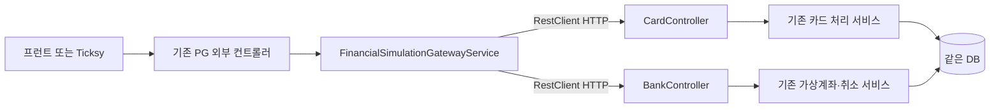

# PG와 모의 은행·카드의 HTTP 호출

> 2026-11-18: 구형 paymentNo 전용 PG/금융 API와 X-Service-Token 전용 PG 인증은 폐쇄했다. 아래의 구형 경로 설명은 이전 구조 기록이며 호출 계약으로 사용하지 않는다. 현재 변경 범위와 보존한 API는 [레거시 정리 기록](payment-legacy-retirement.md)을 따른다. 은행 입금은 `/api/v1/banks/virtual-accounts/deposit`, 환불은 신규 PG 거래·가맹점 범위 API를 사용한다.

2026-11-11 최신 구조: 입금은 BankController의 은행 업무 API다. POST /api/v1/banks/virtual-accounts/deposit에서 은행 상태·입금 이력·은행→PG Outbox를 함께 저장하고, PG는 수신 후 Ticksy에 별도 Outbox로 통보한다. Postman·Bruno도 같은 은행 API를 호출한다. 별도 테스트 컨트롤러와 support 입금 URL은 제거했다. 기존 PG 미연결 계좌의 legacy/deposit 경로는 폐쇄했다. 인증은 기존 X-Payment-Provider-Token을 유지하며 PG→은행의 기존 내부 업무 URL과 금융 인증도 유지한다. [은행 API 상세](payment-gateway-bank-api.md)를 참고한다.

2026-11-06 사용자 요청에 따라 은행·카드 금융 API 진입을 메서드 직접 호출에서 RestClient HTTP 호출로 변경했다. 같은 PG 애플리케이션과 DB를 유지하며 별도 은행/카드 서비스를 배포하지 않는다.

## 컨트롤러 패키지

2026-11-14 PG 컨트롤러 7개를 payment·refund·deposit·expiration 업무별 하위 패키지로 분류했다. 카드·은행 공통 환불 방향에 맞춰 gateway 아래에 card·virtualAccount 패키지를 추가하지 않는다.

```text
controller
├─ gateway                         # PG 요청과 금융 이벤트 수신
│  ├─ payment                      # 결제 준비·승인·계좌 발급·조회
│  │  ├─ GatewayPaymentController
│  │  ├─ GatewayCardCheckoutController
│  │  ├─ GatewayCardPaymentController
│  │  └─ GatewayVirtualAccountController
│  ├─ refund                       # 공통 환불로 확장할 진입점과 기존 결과 확인
│  │  ├─ GatewayPaymentRefundController
│  │  └─ GatewayRefundController
│  ├─ deposit                      # 은행 입금 이벤트 수신
│  │  └─ GatewayBankEventController
│  └─ expiration                   # 은행 만료 이벤트 수신
│     └─ GatewayBankExpirationEventController
├─ financial                       # PG가 HTTP로 호출하는 은행·카드 진입점
│  ├─ BankController
│  └─ CardController
└─ advice                          # 예외 응답 처리
```

GatewayPaymentRefundController는 신규 PG 카드·가상계좌의 환불·철회를 공통 처리하며 저장된 원거래 수단으로 분기한다. GatewayRefundController는 기존 카드·구계좌의 resolve를 유지한다. 카드 금융 처리는 CardController의 gateway/refunds/execute·withdraw를 HTTP로 호출한다. [카드 환불·재시도·철회 계약](payment-gateway-card-refund.md)을 따른다. 결제수단별 기존 컨트롤러의 호환 환불·취소 메서드는 기존 API 계약을 유지한다.

기존 `controller.card`, `controller.virtualAccount`, `controller.refund`의 PG 컨트롤러를 `controller.gateway`로 모으고 `controller.simulation`의 금융 컨트롤러를 `controller.financial`로 이동했다. 클래스명, API URL, 인증 필터 경로와 금융 HTTP 설정은 유지한다. 따라서 금융 내부 URL의 `/internal/financial-simulations` 접두사도 변경하지 않는다. 자바 import와 예외 처리 대상, 테스트의 컨트롤러 참조만 새 패키지에 맞췄다.

2026-11-08 이동 당시 전체 PG 테스트 소스 컴파일과 관련 4개 클래스의 테스트 52개를 실행해 실패·오류·건너뜀 없이 통과했다. `SecurityConfigAuthorizationTest` 22개, `FinancialSimulationHttpIntegrationTest` 13개, `GatewayVirtualAccountIssuanceIntegrationTest` 16개, `GatewayCardHttpContractTest` 1개다. 격리 H2를 사용했으며 실제 DB 변경은 없다. 이전 패키지 참조가 소스에 남지 않고 빌드 출력도 새 패키지에만 생성됐음을 확인했다.

2026-11-14 업무별 패키지 이동 후 보안·금융 HTTP·가맹점 준비/조회·카드 승인·계좌 발급·입금/만료·취소·환불 관련 9개 테스트 클래스, 200개 테스트가 실패·오류·건너뜀 없이 통과했다. 이동한 컨트롤러 7개의 package 선언 외 내용이 동일하고 이전 패키지의 컴파일 출력이 남지 않았음을 확인했다. 실제 DB 변경은 없다.

## 서비스 패키지

서비스도 PG 업무와 금융기관 처리로 나누고 각 계층 아래에 기능별 하위 패키지를 둔다. 2026-11-08 서비스 23개와 대응 테스트 14개를 이동했다.

```text
service
├─ gateway
│  ├─ payment             # PG 거래 준비·조회·명령 트랜잭션
│  ├─ merchant            # 등록 가맹점 자격증명 인증
│  ├─ client              # RestClient를 통한 금융기관 HTTP 호출
│  ├─ card                # PG 카드 승인 조정·확정, 기존 Ticksy 결과 반영·복구
│  ├─ virtualAccount      # PG 계좌 발급 조정·결과 확정·가맹점 통보 Outbox
│  ├─ refund              # PG 환불 프로세스·멱등 결과·실패 기록·resolve
│  └─ notification        # 가맹점 카드 통보 Outbox·계약 어댑터·재시도
└─ financial
   ├─ card                # 기존 카드 처리 진입 서비스·승인/한도/환불
   └─ virtualAccount      # 은행 계좌 발급·입금·취소·만료
```

| 서비스 | 현재 패키지 |
| --- | --- |
| `GatewayPaymentService`, `GatewayPaymentCommandService` | `service.gateway.payment` |
| `MerchantAuthenticationService` | `service.gateway.merchant` |
| `FinancialSimulationGatewayService` | `service.gateway.client` |
| `GatewayCardSettlementService`, `GatewayCardRecoveryScheduler` | `service.gateway.card` |
| `GatewayVirtualAccountIssuanceService`, `GatewayVirtualAccountIssueCommandService`, 입금/만료 통보 Outbox 서비스 4개 | `service.gateway.virtualAccount` |
| `GatewayRefundCreator`, `GatewayRefundFailureRecorder`, `GatewayRefundProcessService`, `GatewayRefundResolutionService` | `service.gateway.refund` |
| `GatewayCardPaymentService`, `GatewayCardApprovalService` | `service.financial.card` |
| `BankVirtualAccountIssuanceService`, `BankVirtualAccountIssueCommandService`, `GatewayVirtualAccountService`, `VirtualAccountCancellationService`, `VirtualAccountExpirationScheduler` | `service.financial.virtualAccount` |

금융 컨트롤러가 사용하는 기존 진입 서비스는 금융 패키지에, Ticksy 결과 반영·재시도와 가맹점 Outbox 발행은 PG 패키지에 둔다. 대응 테스트도 같은 책임의 하위 패키지로 이동했다. 컨트롤러, 인증 필터/설정, 테스트의 import와 명시적 클래스 참조를 함께 수정했다. 서비스명·빈 이름·HTTP 경로·트랜잭션 속성·잠금·스케줄 설정은 유지하며 DB 변경은 없다.

이 단계는 패키지 재배치다. 기존 `GatewayCardApprovalService`의 Ticksy 검증, `GatewayCardPaymentService`의 결과 반영 조정, `GatewayVirtualAccountService`의 공연일 계산 등 남아 있는 기존 결합은 그대로다. 패키지 이동만으로 금융 도메인과 PG의 모든 의존성이 분리됐다고 보지 않는다. 신규 `BankVirtualAccountIssueCommandService`/`BankVirtualAccountIssuanceService`의 PG ID 기반 발급 경로는 계속 Ticksy API를 호출하지 않는다.

서비스 재배치 후 `*.service.*`, `*.security.*`, `*.config.*`, `*.jpa.gateway.*` 범위의 22개 클래스, 테스트 189개가 실패·오류·건너뜀 없이 통과했다. 실제 PostgreSQL 검증 13개를 포함하며 해당 테스트는 DDL validate와 롤백만 사용했다. 검증 후 public 테이블 55개·가맹점 1건이 유지되고 PG/금융 거래와 입금/만료 Outbox는 0건이다. 이동 직전 코드와 대조해 Java 46개 파일에서 package/import와 명시적 타입 경로 외의 코드가 유지됐음을 확인했다. 이전 서비스 경로 참조와 오래된 컴파일 출력이 없고 `git diff --check`도 통과했다.

## 현재 경로



외부 컨트롤러는 금융 서비스를 직접 주입하지 않고 HTTP 중계 서비스를 호출한다. 모의 금융 컨트롤러가 기존 처리 서비스를 주입한다. 모의 컨트롤러는 기존 외부 URL과 다른 경로를 사용하므로 HTTP 호출이 PG 진입점으로 재귀 진입하지 않는다.

새 가맹점 준비/조회 API는 `GatewayPaymentService`를 사용한다. 2026-11-08 [PG 거래 기반 계좌 발급](payment-gateway-account-issuance.md)을 추가해 준비된 은행 거래를 계좌와 연결했다. 이 경로의 은행 서비스는 Ticksy를 호출하지 않는다. 기존 Ticksy 호출 전환과 신규 은행 거래의 입금·취소·환불·만료·통보는 후속 작업이다. 같은 날 [PG 거래 기반 카드 승인](payment-gateway-card-approval.md)을 추가해 신규 카드 원승인과 PG 상태·이력·가맹점 통보를 연결했다.

## API 연결

외부 URL과 JSON 계약을 유지한다. 아래 내부 경로의 공통 접두사는 `/internal/financial-simulations`다.

| 기존 외부 API | 내부 HTTP API |
| --- | --- |
| POST `/api/v1/payments/card/approve` | POST `/cards/approve` |
| GET `/api/v1/payments/card/{paymentNo}` | GET `/cards/payments/{paymentNo}` |
| GET `/api/v1/payments/card/internal/{paymentNo}/approval-exists` | GET `/cards/payments/{paymentNo}/approval-exists` |
| POST `/api/v1/payments/card/refund` | POST `/cards/refund` |
| POST `/api/v1/payments/virtual-account/issue` | POST `/banks/virtual-accounts/issue` |
| GET `/api/v1/payments/virtual-account/internal/{paymentNo}/status` | GET `/banks/virtual-accounts/{paymentNo}` |
| POST `/api/v1/banks/virtual-accounts/legacy/deposit` | BankController에서 기존 은행 입금 서비스를 직접 호출 |
| POST `/api/v1/banks/virtual-accounts/deposit` | BankController에서 PG 연결 은행 입금 서비스를 직접 호출 |
| POST `/api/v1/payments/virtual-account/refund` | POST `/banks/virtual-accounts/refund` |
| POST `/api/v1/payments/virtual-account/cancel` | POST `/banks/virtual-accounts/cancel` |

카드/은행 enum은 기존 요청에 유지한다. 모의 컨트롤러는 카드·은행 도메인별 진입점이며 금융사별 애플리케이션을 새로 만들지 않는다. 환불 resolve는 PG 환불 프로세스 API로 유지한다. 기존 스케줄러와 금융 도메인 내부 호출도 유지한다.

## 인증과 설정

외부 API의 사용자 JWT, Ticksy 서비스 토큰, 입금 제공자 토큰 권한은 그대로다. 외부 요청의 인증을 통과한 뒤 PG가 내부 요청을 새로 생성한다.

- 내부 헤더 `X-PG-Simulation-Token`은 `ROLE_FINANCIAL_SIMULATOR` 전용이다. 기존 사용자/가맹점/입금 제공자 자격증명으로 내부 URL을 호출할 수 없다.
- 카드 예매자 ID는 인증된 외부 principal에서 가져와 `X-PG-User-Id`로 전달한다. 외부 요청이 보내는 같은 이름의 헤더는 사용하지 않는다.
- 토큰 설정이 비어 있으면 프로세스 시작 시 SecureRandom으로 새 토큰을 생성해 PG 클라이언트와 모의 컨트롤러가 공유한다. 소스·DB·로그·응답에 저장하거나 출력하지 않는다.
- 같은 앱 호출의 기본 주소는 현재 웹 서버의 실제 loopback 포트다. 테스트의 임의 포트도 요청 시점에 결정한다.
- `APP_FINANCIAL_SIMULATION_BASE_URL`로 대상을 명시적으로 설정할 수 있다. 다른 프로세스를 호출한다면 양쪽에 같은 `APP_FINANCIAL_SIMULATION_TOKEN`을 주입해야 한다. 요청 본문에서 통보/호출 URL을 받지 않는다.
- 연결 제한은 2초, 읽기 제한은 15초다. `app.financial-simulation.connect-timeout/read-timeout`으로 조정한다. 리다이렉트는 따라가지 않는다.

## 트랜잭션과 재시도

HTTP는 같은 프로세스와 DB라도 다른 서버 요청/트랜잭션이다. 기존의 "PG 메서드 호출과 금융 변경을 하나의 로컬 트랜잭션으로 처리" 목표는 이 HTTP 경계에 적용하지 않는다.

`FinancialSimulationGatewayService`는 `Propagation.NEVER`다. 이미 DB 트랜잭션이 열린 호출자가 금융 HTTP를 수행하려 하면 즉시 거절해 잠금을 보유한 자기 HTTP 호출을 막는다.

모의 금융 컨트롤러 안의 기존 처리 서비스는 기존 트랜잭션을 유지한다. 예를 들어 입금 반영·은행 이력·입금 통보 Outbox 저장은 그 내부 요청에서 함께 커밋하거나 롤백된다. 입금 전 취소와 입금 경합, `RESERVATION_CANCELLED` 수렴도 기존 금융/통보 구현을 유지한다.

새 PG 계좌 발급은 PG 로컬 검증 커밋 → 금융 HTTP → PG 결과 확정의 경계로 처리한다. 금융 응답 유실/PG 확정 실패 후에는 같은 PG ID로 은행 발급 결과를 조회해 복구한다. PG 상태와 발급 이력은 함께 커밋/롤백하지만 HTTP를 가로지르는 원자적 커밋은 없다. 기존 Ticksy 전용 입금/취소/만료 처리는 PG에 연결하지 않은 계좌만 대상으로 한다.

중계 계층은 업무 요청을 자동 재시도하거나 새 결제/환불 ID를 생성하지 않는다. 기존 paymentNo와 환불 프로세스 ID를 그대로 전달한다. 연결/응답 시간 초과는 `503 FINANCIAL_PROVIDER_UNAVAILABLE`로 반환하고 금융 실패·취소 상태로 바꾸지 않는다. 모의 금융 저장소 오류는 해당 서비스의 롤백 후 `503 FINANCIAL_STORAGE_UNAVAILABLE`로 반환한다.

`RestClient.exchange`로 금융 서버의 상태와 JSON 본문을 읽는다. 2026-11-09 [금융/PG 응답 DTO 분리](payment-gateway-response-contract.md)로 byte[] 전달을 제거했다. 성공은 금융 전용 DTO에서 PG 응답으로 변환하고, `202 PENDING`·업무/인증/저장소 오류는 각각의 DTO와 예외 응답 경로로 상태·기존 필드를 유지한다. 202나 400/403을 200 승인으로 바꾸지 않는다. API 요청/응답 본문과 카드 비밀정보를 로그로 추가하지 않는다.

같은 웹 서버에 두 HTTP 요청이 필요하므로 별도 금융 서비스를 배포한 운영 환경과 동시 처리 용량이 같지는 않다. 이 단계는 한 애플리케이션 안에서 금융 HTTP 경계를 모의하는 구조다.

## 검증

`FinancialSimulationHttpIntegrationTest`는 임의 포트의 실제 서버와 RestClient loopback HTTP를 사용한다. 외부 컨트롤러 진입은 MockMvc로 인증하고 내부 금융 처리는 실제 서버의 별도 보안 필터를 통과한다. 은행 처리는 격리 H2의 실제 서비스/트랜잭션으로 실행한다.

승인 응답과 예매자 전달, 202/400/403 보존, 내부 URL의 외부 자격증명 거절, 은행 중복 발급·금액 불일치·상태 조회, 중복 입금과 Outbox, Outbox 저장 실패의 전체 롤백, 중복 취소, 환불 요청 ID 전달, 트랜잭션 중 HTTP 금지, 연결 실패의 503을 검증한다. 기존 카드·계좌·환불 회귀도 함께 실행한다.

2026-11-06 아래 범위로 `BUILD SUCCESSFUL`을 확인했다.

```powershell
.\gradlew.bat :payment-gateway-service:test `
  --tests '*.service.*' --tests '*.security.*' --tests '*.config.*' --tests '*.jpa.gateway.*' `
  --offline --no-daemon --console=plain
```

| 실행 범위 | 테스트 | 실패/오류/건너뜀 |
| --- | --- | --- |
| 전체 PG 선택 범위, 21개 클래스 | 172 | 각 0 |
| 위 범위 중 실제 loopback HTTP 통합 테스트 | 13 | 각 0 |
| 위 범위 중 내부 인증 토큰 테스트 | 2 | 각 0 |
| 위 범위 중 실제 PostgreSQL 검증 | 12 | 각 0 |

실제 PostgreSQL 검증에는 기반 문서의 `GATEWAY_CORE_VERIFY_URL/USER/PASSWORD`를 설정하고 DDL validate와 각 테스트 롤백만 사용했다. 기존 금융 테스트의 임시 PostgreSQL 포트 변수는 설정하지 않았다. 종료 후 실제 public 테이블 55개, 기존 가맹점 1건, PG/금융 검증 거래 0건을 확인했다. 이번 HTTP 변경에는 DB 스키마 변경이 없다.
