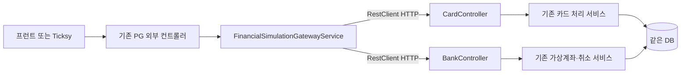

# PG와 모의 은행·카드의 HTTP 호출

2026-11-06 사용자 요청에 따라 은행·카드 금융 API 진입을 메서드 직접 호출에서 RestClient HTTP 호출로 변경했다. 같은 PG 애플리케이션과 DB를 유지하며 별도 은행/카드 서비스를 배포하지 않는다.

## 현재 경로



외부 컨트롤러는 금융 서비스를 직접 주입하지 않고 HTTP 중계 서비스를 호출한다. 모의 금융 컨트롤러가 기존 처리 서비스를 주입한다. 모의 컨트롤러는 기존 외부 URL과 다른 경로를 사용하므로 HTTP 호출이 PG 진입점으로 재귀 진입하지 않는다.

새 가맹점 준비/조회 API는 기존 `GatewayPaymentService`를 사용한다. 아직 준비 거래를 카드 승인/계좌 발급에 연결하지 않았으며, 가맹점별 금융 처리와 금융 서비스에서 Ticksy 검증·통보를 제거하는 후속 책임 분리까지 완료한 변경은 아니다.

## API 연결

외부 URL과 JSON 계약을 유지한다. 아래 내부 경로의 공통 접두사는 `/internal/financial-simulations`다.

| 기존 외부 API | 내부 HTTP API |
| --- | --- |
| POST `/api/v1/payments/card/approve` | POST `/cards/approve` |
| GET `/api/v1/payments/card/{paymentNo}` | GET `/cards/payments/{paymentNo}` |
| GET `/api/v1/payments/card/internal/{paymentNo}/approval-exists` | GET `/cards/payments/{paymentNo}/approval-exists` |
| POST `/api/v1/payments/card/refund` | POST `/cards/refund` |
| POST `/api/v1/payments/virtual-account/issue` | POST `/banks/virtual-accounts/issue` |
| GET `/api/v1/payments/virtual-account/internal/{paymentNo}/status` | GET `/banks/virtual-accounts/{paymentNo}` |
| POST `/api/v1/payments/virtual-account/deposit` | POST `/banks/virtual-accounts/deposit` |
| POST `/api/v1/payments/virtual-account/refund` | POST `/banks/virtual-accounts/refund` |
| POST `/api/v1/payments/virtual-account/cancel` | POST `/banks/virtual-accounts/cancel` |

카드/은행 enum은 기존 요청에 유지한다. 모의 컨트롤러는 카드·은행 도메인별 진입점이며 금융사별 애플리케이션을 새로 만들지 않는다. 환불 resolve는 PG 환불 프로세스 API로 유지한다. 기존 스케줄러와 금융 도메인 내부 호출도 유지한다.

## 인증과 설정

외부 API의 사용자 JWT, Ticksy 서비스 토큰, 입금 제공자 토큰 권한은 그대로다. 외부 요청의 인증을 통과한 뒤 PG가 내부 요청을 새로 생성한다.

- 내부 헤더 `X-PG-Simulation-Token`은 `ROLE_FINANCIAL_SIMULATOR` 전용이다. 기존 사용자/가맹점/입금 제공자 자격증명으로 내부 URL을 호출할 수 없다.
- 카드 예매자 ID는 인증된 외부 principal에서 가져와 `X-PG-User-Id`로 전달한다. 외부 요청이 보내는 같은 이름의 헤더는 사용하지 않는다.
- 토큰 설정이 비어 있으면 프로세스 시작 시 SecureRandom으로 새 토큰을 생성해 PG 클라이언트와 모의 컨트롤러가 공유한다. 소스·DB·로그·응답에 저장하거나 출력하지 않는다.
- 같은 앱 호출의 기본 주소는 현재 웹 서버의 실제 loopback 포트다. 테스트의 임의 포트도 요청 시점에 결정한다.
- `APP_FINANCIAL_SIMULATION_BASE_URL`로 대상을 명시적으로 설정할 수 있다. 다른 프로세스를 호출한다면 양쪽에 같은 `APP_FINANCIAL_SIMULATION_TOKEN`을 주입해야 한다. 요청 본문에서 통보/호출 URL을 받지 않는다.
- 연결 제한은 2초, 읽기 제한은 15초다. `app.financial-simulation.connect-timeout/read-timeout`으로 조정한다. 리다이렉트는 따라가지 않는다.

## 트랜잭션과 재시도

HTTP는 같은 프로세스와 DB라도 다른 서버 요청/트랜잭션이다. 기존의 "PG 메서드 호출과 금융 변경을 하나의 로컬 트랜잭션으로 처리" 목표는 이 HTTP 경계에 적용하지 않는다.

`FinancialSimulationGatewayService`는 `Propagation.NEVER`다. 이미 DB 트랜잭션이 열린 호출자가 금융 HTTP를 수행하려 하면 즉시 거절해 잠금을 보유한 자기 HTTP 호출을 막는다.

모의 금융 컨트롤러 안의 기존 처리 서비스는 기존 트랜잭션을 유지한다. 예를 들어 입금 반영·은행 이력·입금 통보 Outbox 저장은 그 내부 요청에서 함께 커밋하거나 롤백된다. 입금 전 취소와 입금 경합, `RESERVATION_CANCELLED` 수렴도 기존 금융/통보 구현을 유지한다.

향후 실제 PG 거래 상태를 금융 처리에 연결할 때는 PG 로컬 준비 커밋 → 금융 HTTP → PG 결과 확정의 경계로 다룬다. 금융 응답이 유실됐다고 금융이 롤백됐다고 가정하지 않으며 동일한 PG/작업 식별자로 금융 상태를 조회해 복구해야 한다. HTTP를 가로지르는 원자적 커밋을 주장하지 않는다.

중계 계층은 업무 요청을 자동 재시도하거나 새 결제/환불 ID를 생성하지 않는다. 기존 paymentNo와 환불 프로세스 ID를 그대로 전달한다. 연결/응답 시간 초과는 `503 FINANCIAL_PROVIDER_UNAVAILABLE`로 반환하고 금융 실패·취소 상태로 바꾸지 않는다. 모의 금융 저장소 오류는 해당 서비스의 롤백 후 `503 FINANCIAL_STORAGE_UNAVAILABLE`로 반환한다.

`RestClient.exchange`로 금융 서버의 상태와 JSON 본문을 전달한다. `202 PENDING`, 400 거절, 403 소유권 거절을 200 승인으로 바꾸지 않는다. HTTP 중계의 자바 응답 타입은 byte[]지만 HTTP 응답은 기존 JSON이다. API 요청/응답 본문과 카드 비밀정보를 로그로 추가하지 않는다. [Spring RestClient 공식 문서](https://docs.spring.io/spring-framework/reference/6.2/integration/rest-clients.html#rest-restclient-exchange).

같은 웹 서버에 두 HTTP 요청이 필요하므로 별도 금융 서비스를 배포한 운영 환경과 동시 처리 용량이 같지는 않다. 이 단계는 한 애플리케이션 안에서 금융 HTTP 경계를 모의하는 구조다.

## 검증

`FinancialSimulationHttpIntegrationTest`는 임의 포트의 실제 서버와 RestClient loopback HTTP를 사용한다. 외부 컨트롤러 진입은 MockMvc로 인증하고 내부 금융 처리는 실제 서버의 별도 보안 필터를 통과한다. 은행 처리는 격리 H2의 실제 서비스/트랜잭션으로 실행한다.

승인 응답과 예매자 전달, 202/400/403 보존, 내부 URL의 외부 자격증명 거절, 은행 중복 발급·금액 불일치·상태 조회, 중복 입금과 Outbox, Outbox 저장 실패의 전체 롤백, 중복 취소, 환불 요청 ID 전달, 트랜잭션 중 HTTP 금지, 연결 실패의 503을 검증한다. 기존 카드·계좌·환불 회귀도 함께 실행한다.

2026-11-06 아래 범위로 `BUILD SUCCESSFUL`을 확인했다.

```powershell
.\gradlew.bat :payment-gateway-service:test `
  --tests '*.service.*' --tests '*.security.*' --tests '*.config.*' --tests '*.jpa.gateway.*' `
  --offline --no-daemon --console=plain
```

| 실행 범위 | 테스트 | 실패/오류/건너뜀 |
| --- | --- | --- |
| 전체 PG 선택 범위, 21개 클래스 | 172 | 각 0 |
| 위 범위 중 실제 loopback HTTP 통합 테스트 | 13 | 각 0 |
| 위 범위 중 내부 인증 토큰 테스트 | 2 | 각 0 |
| 위 범위 중 실제 PostgreSQL 검증 | 12 | 각 0 |

실제 PostgreSQL 검증에는 기반 문서의 `GATEWAY_CORE_VERIFY_URL/USER/PASSWORD`를 설정하고 DDL validate와 각 테스트 롤백만 사용했다. 기존 금융 테스트의 임시 PostgreSQL 포트 변수는 설정하지 않았다. 종료 후 실제 public 테이블 55개, 기존 가맹점 1건, PG/금융 검증 거래 0건을 확인했다. 이번 HTTP 변경에는 DB 스키마 변경이 없다.
