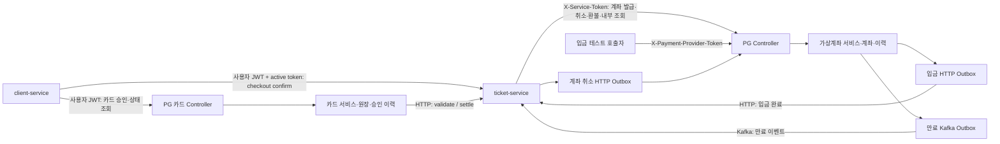

# Payment Gateway 책임 분리 사전 분석

분석일: 2026-11-04 (Asia/Seoul). 기준 커밋: `2fdd3d98`.

이번 단계는 기존 결제·인증·Outbox 흐름 분석이다. 애플리케이션 코드와 스키마는 변경하지 않았으며 실제 DB에 SQL을 실행하지 않았다. 아래의 변경 방향은 후속 설계·구현을 위한 제안이며, 현재 동작과 구분해서 기술한다.

문서에서 Ticksy는 이 저장소의 `ticket-service`와 사용자 프런트엔드 `client-service`를 의미한다. 실행 중인 서비스·DB 데이터가 아니라 현재 소스와 테스트를 조사했다.

분석 이후 합의한 설계는 [PG 가맹점·거래·식별자 설계](payment-gateway-domain-design.md)를 따른다. 프런트엔드의 직접 PG 호출을 유지하고 PG 결제 세션으로 merchant 범위를 연결하며, 금융사별 서비스가 공통 금융 서비스를 주입받는다. 아래 8.1절은 합의 이전의 대안 검토 기록이다.

## 1. 핵심 결론

1. 현재 PG에는 가맹점과 공통 PG 거래 모델이 없다. 카드 승인 이력과 가상계좌가 Ticksy의 `paymentNo`를 직접 보관한다.
2. 카드 결제의 실제 승인 진입점은 **브라우저 → PG**다. 가상계좌 발급·취소·환불은 **Ticksy → PG**다. 카드까지 Ticksy 경유로 통일하려면 프런트엔드와 Ticksy API 변경이 필요하다.
3. 컨트롤러는 이미 DTO 검증과 서비스 호출 위주다. 주요 변경 지점은 서비스·인증·영속 모델·통보 처리다.
4. 카드 승인 서비스 안에 Ticksy 사전 검증 HTTP 호출이 있고, 카드 승인 상태에 Ticksy 완료 통보 상태가 섞여 있다. 가상계좌 서비스에는 공연일 기반 입금기한 정책이 있다.
5. 가상계좌 입금·입금 전 취소의 로컬 트랜잭션과 Outbox 복구 구조는 이미 구현되어 있다. 이를 PG 거래 상태와 연결하면서 보존해야 한다.
6. 카드 완료 통보에는 전용 Outbox가 없다. 승인 이력의 상태와 복구 스케줄러가 전달 재시도 역할을 한다.
7. `paymentNo`의 전역 유니크 제약과 단독 조회, 환불 프로세스 ID의 전역 기본 키는 다중 가맹점 요구사항에 맞지 않는다.
8. 카드 원장과 승인 거래는 이미 분리되어 있다. 이 관계를 유지하고 승인 거래에 `pg_payment_id`를 연결하면 된다.

## 2. 실제 호출 경로와 인증



은행·카드 처리는 이미 같은 PG 애플리케이션의 JPA 엔티티와 메서드 호출로 이루어진다. 은행·카드 별도 서비스나 내부 HTTP 클라이언트는 없다. PG에 별도의 트랜잭션 관리자 설정은 발견되지 않았으며 일반 Spring/JPA 트랜잭션을 사용한다.

### 2.1 외부 경로와 권한

아래 PG 경로 앞에는 프록시를 통과할 때 `/payment-gateway`가 붙는다. Nginx가 이 접두사를 제거한다.

| 호출자 | API | 현재 인증·접근 조건 |
| --- | --- | --- |
| 브라우저 → Ticksy | `POST /ticket/api/v1/checkout/prepare`, `/confirm` | 사용자 JWT, checkout의 active token 및 좌석·소유자 검증 |
| 브라우저 → PG | `POST /api/v1/payments/card/approve` | `ROLE_USER`, JWT subject를 예매자 ID로 전달 |
| 브라우저 → PG | `GET /api/v1/payments/card/{paymentNo}` | `ROLE_USER`, 승인 이력의 예매자 ID 일치 검사 |
| Ticksy → PG | `GET /api/v1/payments/card/internal/{paymentNo}/approval-exists` | `ROLE_INTERNAL_SERVICE` |
| Ticksy → PG | `POST /api/v1/payments/card/refund` | `ROLE_INTERNAL_SERVICE` |
| Ticksy → PG | `POST /api/v1/payments/virtual-account/issue`, `/cancel`, `/refund` | `ROLE_INTERNAL_SERVICE` |
| Ticksy → PG | `GET /api/v1/payments/virtual-account/internal/{paymentNo}/status` | `ROLE_INTERNAL_SERVICE` |
| Ticksy → PG | `POST /api/v1/payments/refunds/internal/resolve` | `ROLE_INTERNAL_SERVICE` |
| 입금 테스트 호출자 → PG | `POST /api/v1/payments/virtual-account/deposit` | 별도 `ROLE_PAYMENT_PROVIDER` |
| PG → Ticksy | `POST /api/v1/payments/internal/card/validate`, `/settle`, `/complete`, `/fail` | `X-Service-Token` |
| PG → Ticksy | `POST /api/v1/payments/internal/virtual-account/deposit/complete` | `X-Service-Token` |

PG 카드 승인·사용자 상태 조회는 현재 관리자 역할이나 내부 서비스 역할로 대신 호출할 수 없다. Ticksy에 카드 중계 API를 추가할 때 이 권한 계약도 함께 변경해야 한다.

### 2.2 자격증명

- 사용자 인증: 공통 `JwtAuthenticationFilter`가 서명·만료·access token 종류를 검사하고 Redis의 사용자 활성 상태·token version·role을 대조한다. JWT에는 현재 가맹점 claim이 없다.
- 서비스 인증: 양방향 Feign 호출이 `X-Service-Token`을 사용한다. 운영 설정은 `APP_INTERNAL_SERVICE_TOKEN`을 주입한다. PG의 인증 principal은 고정 문자열 `ticket-service`이고 merchant 연결은 없다.
- 입금 인증: `X-Payment-Provider-Token`과 `APP_PAYMENT_PROVIDER_TOKEN`을 사용한다. 가맹점의 계좌 발급·취소 권한과 구분되어 있다.
- 프런트엔드: `authenticatedRequest.ts`가 sessionStorage의 access token을 Bearer 헤더에 넣는다. 401이면 auth-service에서 갱신한 뒤 같은 요청을 재전송한다. 서비스 토큰은 브라우저에 전달하지 않는다.
- 로컬 설정에는 개발용 토큰 기본값이 있다. 신규 가맹점 자격증명을 이 값이나 마이그레이션의 리터럴 비밀값으로 만들면 안 된다.

**재사용 검토:** 기존 서비스 토큰은 최초 Ticksy 가맹점의 서버 인증 수단으로 재사용할 수 있다. 다만 검증 결과를 단순 내부 서비스 role이 아니라 등록된 merchant에 연결해야 한다. 가맹점이 늘면 가맹점별 자격증명을 사용해야 하며, 하나의 공유 토큰으로 여러 merchant를 구분할 수는 없다. 본문의 `merchant_id`만으로 인증 범위를 바꾸면 안 된다. 사용자 JWT에 의한 예매 소유자 검증도 별도로 유지한다.

현재 통보 대상은 `TicketPaymentClient`의 고정 base URL과 경로다. 일반 결제 요청에 임의 callback URL을 받는 구조는 아니다. `TicketServiceFeignConfig`의 토큰 interceptor는 전역 Bean이므로, 여러 가맹점 클라이언트를 도입할 때 Ticksy용 토큰이 다른 대상에 붙지 않도록 적용 범위를 검토해야 한다.

## 3. 카드 승인·취소·환불

### 3.1 승인

1. Ticksy `CheckoutService.confirm`은 서버에서 금액을 계산하고 `READY` Payment를 저장한다. 카드 승인은 이 단계에서 호출하지 않는다.
2. 프런트엔드 `CardPaymentDialog`가 `paymentNo`, 금액, 카드사·카드번호·CVC·비밀번호를 PG `/card/approve`로 보낸다. 현재 카드 원문은 Ticksy를 통과하지 않는다.
3. `GatewayCardPaymentService`는 전체 트랜잭션 없이 승인 서비스와 완료 통보 서비스를 순서대로 호출한다.
4. `GatewayCardApprovalService.approve`의 트랜잭션에서 기존 `paymentNo` 승인 이력을 조회한다. 신규 요청이면 카드 행을 비관적으로 잠그고 카드 정보·활성 상태·만료·한도를 검사한다.
5. **카드 행 잠금을 유지한 상태에서** Ticksy `/internal/card/validate`를 호출한다. Ticksy는 Payment를 잠그고 소유자·수단·READY·기한을 검사하고 `APPROVAL_REQUESTED` 이력을 반영한다.
6. PG는 검증 응답의 결제번호·수단·상태·금액을 확인한다. 서버 금액으로 카드 사용액을 증가시키고 `CARD-UUID` 거래번호와 `APPROVED` 승인 이력을 함께 커밋한다.
7. 입력·사전 검증 실패는 PG 트랜잭션을 롤백한다. 현재 신규 승인 실패 이력을 저장하거나 Ticksy의 Payment를 FAILED로 바꾸지 않는다. Ticksy의 사전 검증 트랜잭션까지 함께 롤백되는 것은 아니다.

카드 소유자와 예매자는 구분된다. 다른 명의의 카드도 카드 인증 정보가 맞으면 결제할 수 있고, 예매 소유자는 로그인 사용자다. 환불은 실제 승인에 사용한 카드에 반영한다. 이 동작을 단순 `card.userId == buyer.userId` 조건으로 바꾸면 회귀다.

### 3.2 완료 통보와 승인 취소

- `GatewayCardSettlementService.settle`은 별도 트랜잭션에서 승인 이력을 잠그고 Ticksy `/internal/card/settle`을 호출한다.
- Ticksy는 소유자·금액·수단을 검증한다. 결제가 가능하면 Payment·예매·티켓·좌석을 완료하고 `COMPLETED`를 반환한다. 이미 결제·환불된 건도 기존 카드 거래번호가 같을 때 완료 결과를 재응답한다.
- Ticksy가 확정적으로 거부한 `EXPIRED`·`CANCELLED`·`FAILED` 또는 BANK_TRANSFER 전환 결과에 한해 PG가 카드 사용액을 복원하고 승인 이력을 `CANCELLED`로 커밋한다.
- HTTP 오류·응답 유실·불명확한 응답·PG 완료 저장 실패만으로 승인을 취소하지 않는다. 승인 사실을 유지하고 HTTP **202**, `status: PENDING`, `paymentNo`를 반환한다.
- 브라우저는 같은 결제번호로 상태를 조회한다. 기본 3초 후 다음 조회를 시도하며 응답 유실 상태를 sessionStorage에 보관한다. PG 복구 스케줄러는 기본 30초마다 최대 100건의 `APPROVED`·`TICKET_PAYMENT_FAILED`를 같은 거래번호로 재통보한다.
- 신규 승인 동시성은 카드 행 잠금과 `payment_no` 유니크 제약으로 이중 차감을 막는다. 존재하지 않는 승인 이력의 조회가 결제번호 범위 잠금을 만들어 주지는 않는다. 최초 삽입 충돌을 모두 정상 재응답으로 변환하는 구현은 아니다.

현재 카드 상태는 `APPROVED`, `APPROVAL_FAILED`, `TICKET_PAYMENT_COMPLETED`, `TICKET_PAYMENT_FAILED`, `CANCELLED`, `PARTIALLY_REFUNDED`, `REFUNDED`다. **금융 처리 상태와 가맹점 통보 상태가 같은 enum에 있다.** `APPROVAL_FAILED` 및 기존 complete/fail API는 남아 있지만 신규 승인 정상 흐름은 validate/settle을 사용한다. 독립적인 공개 카드 취소 API는 없고, 확정 거절의 승인 보상 취소 또는 결제 후 환불로 처리한다.

### 3.3 환불

Ticksy의 예매 취소 서비스가 저장된 Payment의 수단으로 카드·계좌 환불을 분기한다. 카드 전체·부분 환불 모두 동일 PG `/card/refund`를 사용하며 `paymentRefundProcessId`, `paymentNo`, 원승인 `transactionId`, 환불액을 보낸다.

PG는 승인 이력 → 카드 행 순으로 잠근다. 환불 가능 상태와 잔액을 확인하고 카드 사용액 복원·승인 이력 누적 환불액/상태·`gateway_refunds.SUCCEEDED`를 같은 트랜잭션으로 반영한다. 성공한 프로세스의 재요청은 이후 다른 부분 환불이 있었더라도 해당 프로세스의 최초 성공 응답을 반환한다. 환불 공통 복구 구조는 6절을 따른다.

## 4. 가상계좌 발급·입금·만료·취소·환불

### 4.1 발급

- Ticksy checkout confirm 트랜잭션 안에서 `CheckoutVirtualAccountService`가 PG에 `paymentNo`, 은행, 서버 금액, **공연일시**를 전송한다. PG는 Ticksy에 발급 검증 HTTP를 다시 호출하지 않는다.
- `GatewayVirtualAccountService.issue`가 `paymentNo`로 기존 계좌를 잠가 조회한다. 기존 은행·금액이 다르면 거절한다. 기존 발급 요청 재전송의 공연일시는 비교하지 않는다.
- 신규 계좌는 은행 접두사와 난수로 번호를 생성하고 중복 여부를 최대 5번 검사한다. 최종 계좌번호 및 결제번호 중복은 DB 유니크 제약으로도 막는다. 동시 최초 발급의 유니크 충돌 복구는 별도 구현되어 있지 않다.
- 현재 PG가 공연 당일/이전 발급을 거부하고, 공연이 내일이면 오늘 23:59:59, 더 나중이면 내일 23:59:59를 입금기한으로 계산한다. 이는 Ticksy 업무 정책이다.
- Ticksy는 발급 응답을 Payment에 반영하고 `WAITING_DEPOSIT`로 커밋한다. **PG 발급 성공 뒤 Ticksy 저장이 실패하면 PG 계좌만 남을 수 있다.** 서비스 간 단일 트랜잭션은 아니다.
- 기존 발급 건 재조회 시 기한이 지났으면 계좌·만료 이력·만료 Outbox를 함께 저장한다.

후속 분리에서는 Ticksy가 업무 정책으로 기한을 결정하고 PG/은행에는 일반적인 `depositDeadline` 또는 `expiresAt`을 전달하는 방향이 적합하다.

### 4.2 입금

1. 입금 테스트 API는 제공자 토큰으로 접근하며 계좌번호·입금자·금액·선택적 입금시각을 받는다.
2. 계좌번호로 계좌 행을 비관적으로 잠그고, 대기 상태·기한·정확한 금액을 검증한다. 시각은 마이크로초 단위로 정규화한다.
3. 계좌 `DEPOSITED`, 최초 입금자/시각, 입금 이력, `virtual_account_deposit_outbox.PENDING`을 같은 트랜잭션에서 커밋한다. Outbox enqueue는 `MANDATORY`다.
4. `afterCommit`에서 최초 전달을 시도하고, 실패·서버 종료는 스케줄러가 복구한다. 전달은 별도 `REQUIRES_NEW`에서 Outbox 행을 잠그며, HTTP 대기 중 원래 입금 트랜잭션의 계좌 잠금을 유지하지 않는다. 최초 전달 자체는 동기 후처리이므로 입금 API 응답 시간에 영향을 줄 수 있다.
5. Ticksy는 예매 → Payment 순서로 잠근다. 계좌·은행·금액·입금기한을 확인하고 결제·예매·티켓·좌석을 완료한다. 이미 PAID/부분 환불/전체 환불인 경우에도 최초 입금자·시각이 같은 재통보만 성공으로 인정한다.
6. PG가 응답의 결제번호·수단·금액·은행·계좌·입금자·시각·완료 상태를 검증한 뒤 Outbox를 `DELIVERED`로 바꾼다. 정상 입금 계좌는 `DEPOSITED`를 유지한다.

같은 입금의 재요청은 금액·입금자·명시된 시각을 대조하고 새 이력·알림을 만들지 않는다. 다만 현재 `hasDeposit()`은 `status == DEPOSITED`로 판단한다. 입금 후 취소된 계좌는 입금 정보가 남아 있어도 이 메서드가 false이므로, 취소 후 동일 입금 API 재요청은 성공 재응답 경로에 들어가지 않는다. 금융 사실과 현재 처리 가능 상태를 분리할 때 함께 검토해야 한다.

### 4.3 만료

- PG 만료 스케줄러는 기본 자정에 실행한다. 기한이 지난 WAITING_DEPOSIT 계좌를 최대 100개씩 비관적으로 잠그고 만료·이력·`virtual_account_outbox_events.PENDING`을 저장한다.
- 반복 배치 전체가 현재 하나의 `@Transactional` 호출에 들어 있어, 처리량이 많으면 앞 배치 잠금도 최종 커밋까지 유지된다.
- 만료 Outbox publisher는 기본 30초마다 최대 100건을 Kafka로 전송하고 브로커 발행 성공에 `PUBLISHED`로 바꾼다. 이는 Ticksy의 업무 반영 완료와 다른 의미다.
- 이 publisher에는 Outbox 행의 비관적 잠금/claim이 없다. 여러 인스턴스가 같은 이벤트를 중복 발행할 가능성을 고려해야 한다. 수신 측은 상태와 식별 정보를 검사해 반복 반영을 막는다.
- Ticksy의 `VirtualAccountExpiredConsumer`가 입금과 같은 예매 → Payment 잠금 순서를 사용한다. 이미 입금·환불·예매 취소된 건은 상태를 되돌리지 않는다.
- Ticksy Kafka consumer는 실패 시 1초 간격으로 3회 재시도한 뒤 원토픽의 `.DLT`로 보낸다. PG Outbox의 PUBLISHED 이후 수신 실패는 별도의 소비 재시도/DLT 운영 범위다.
- Ticksy의 로컬 만료 스케줄러는 발급된 BANK_TRANSFER/WAITING_DEPOSIT를 제외한다. 기한 내 입금의 통보 지연을 고려해 PG 만료 이벤트로 확정한다.

### 4.4 입금 전 예매 취소와 경합

1. 사용자 취소는 Ticksy에서 예매 소유자를 검사한다. 사용자·관리자 취소는 예매의 NOWAIT 잠금을 사용하며 경합 시 기존 `409 / RESERVATION_CANCELLATION_IN_PROGRESS` 계약을 유지한다.
2. 입금 전 계좌 결제는 전체 취소만 허용한다. 예매 → 결제 → 구매 매수·티켓 → 좌석의 잠금/처리 순서를 맞춰 예매·티켓·Payment를 CANCELLED, 좌석을 AVAILABLE로 바꾸고 계좌 취소 Outbox를 함께 저장한다. 기존 입금 전 취소의 쿠폰 정책을 유지한다.
3. Ticksy의 스케줄러가 Outbox 행만 잠근 별도 트랜잭션에서 PG 취소 API를 호출한다. 원래 예매·Payment 잠금 아래에서는 이 취소 HTTP를 호출하지 않는다.
4. PG는 입금과 같은 계좌 행을 잠그고 refresh한 뒤 결제번호·은행명·계좌번호·금액을 검증한다. 대기·만료·입금 상태를 CANCELLED로 수렴시키며, 이미 CANCELLED이면 성공을 재응답하고 취소 이력을 추가하지 않는다.
5. 입금 반영 전에 Ticksy 취소가 커밋되면 입금 완료 API가 HTTP 200의 `RESERVATION_CANCELLED`와 취소 Payment를 반환한다. PG는 계좌 취소·취소 이력·입금 Outbox DELIVERED를 하나의 트랜잭션으로 커밋한다. 별도 취소 요청과 순서가 바뀌어도 이력을 중복 생성하지 않는다.
6. Ticksy의 입금 반영이 먼저 커밋되어 PAID라면 기존 결제 후 취소·환불 절차로 진행한다. 취소 후 늦게 온 입금·만료 통보는 예매를 되살리거나 재판매된 좌석을 해제하지 않는다.

입금 후 계좌 취소는 최초 입금자·입금시각·금액·입금 이력을 지우지 않는다. **CANCELLED가 실제 자금 반환을 의미하지 않는다.** 실제 늦은 입금 반환은 구현되어 있지 않다. 현재 입금 테스트 API는 취소·만료된 계좌의 신규 입금을 수락하지 않으므로, 이미 수락된 입금의 지연 통보와 취소 후 신규 입금 시도도 구분해야 한다.

### 4.5 계좌 환불

Ticksy가 환불 프로세스 ID와 원결제번호·환불 계좌·금액을 PG에 전송한다. PG는 원계좌를 잠그고 입금 여부를 확인한다. 같은 `paymentNo`와 BANK_TRANSFER의 `SUCCEEDED` 환불 합계로 잔액을 계산하고, 환불 이력과 `gateway_refunds.SUCCEEDED`를 함께 커밋한다. 계좌 자체의 상태는 환불 상태로 바꾸지 않는다.

현재 모의 은행에서 DB 환불 이력 저장이 환불 실행이다. 은행 이력의 입금액·실제 입금시각은 계좌/입금 Outbox에 있고, 환불 상세는 일부가 이력 메시지와 공통 환불 기록에 있다. 후속 데이터 이전에서 이력 메시지를 임의 변환하거나 최초 입금 사실을 삭제하면 안 된다.

## 5. Outbox·스케줄러·재시도 비교

| 처리 | 영속 재처리 기준 | 외부 전달·완료 기준 | 재시도·잠금 |
| --- | --- | --- | --- |
| PG → Ticksy 카드 완료 | 카드 승인 이력의 APPROVED/TICKET_PAYMENT_FAILED | HTTP settle의 검증된 COMPLETED 또는 확정 REJECTED | 기본 30초, 최대 100건, 승인 이력 잠금 중 HTTP. 전용 Outbox 없음 |
| PG → Ticksy 계좌 입금 | `virtual_account_deposit_outbox` | HTTP APPLIED 또는 RESERVATION_CANCELLED 응답 검증 후 DELIVERED | 커밋 직후 최초 시도 + 기본 30초 재시도, 최대 100건, 다음 시각·오류·횟수, Outbox 잠금 |
| PG → Kafka 계좌 만료 | `virtual_account_outbox_events` | 브로커 발행 성공 후 PUBLISHED | 기본 30초, 최대 100건, 실패 횟수·메시지, 별도 claim/행 잠금 없음 |
| Ticksy → PG 계좌 취소 | `virtual_account_cancel_outbox` | 식별 정보와 CANCELLED 응답 검증 후 DELIVERED | 기본 30초, 최대 100건, 다음 시각·오류·횟수, Outbox 잠금 |
| Ticksy → PG 결제 후 환불 | Ticksy 환불 프로세스·스냅샷 + PG `gateway_refunds` | 성공 저장·resolve 조회로 판정 | 같은 프로세스 재시도/수동 복구. 일반 통보 Outbox와 다른 구조 |

입금·취소 Outbox의 HTTP 오류, 응답 불일치와 응답 유실은 PENDING을 유지하며 횟수 상한은 없다. 상대 서비스가 성공한 뒤 전달 완료 저장이 롤백되어도 같은 내용으로 재전달한다. 카드도 승인 이력을 통해 동일 거래번호로 복구한다. 이 전달 보장은 exactly-once 전송이 아니라 **재전달과 수신 멱등 처리의 결합**이다.

새 은행↔PG 또는 카드↔PG Outbox는 필요 없다. 유지·확장할 경계는 Ticksy↔PG와 기존 Kafka 전달 경계다. 현재 Outbox에는 merchant와 PG 거래 식별자가 없으며 대상은 Ticksy에 고정되어 있다.

## 6. 트랜잭션과 락의 경계

| 단위 | 함께 커밋되는 변경 | 경계 밖/주의점 |
| --- | --- | --- |
| PG 카드 승인 | 카드 사용액 + 승인 거래 | Ticksy validate는 별도 서비스 트랜잭션. 현재 카드 잠금 중 HTTP |
| PG 카드 완료/보상 | 통보 상태 또는 카드 사용액 복원 + 승인 취소 | 현재 승인 이력 잠금 중 Ticksy settle HTTP |
| PG 계좌 발급 | 계좌 + 발급 이력 | 호출한 Ticksy checkout 트랜잭션과 독립 |
| PG 계좌 입금 | 계좌 입금 + 이력 + 입금 Outbox | Ticksy 호출은 커밋 후, 실패해도 입금 사실 유지 |
| PG 만료 | 계좌 만료 + 이력 + 만료 Outbox | Kafka 전송은 별도 실행 |
| Ticksy 입금 전 취소 | 예매·티켓·Payment·좌석·취소 Outbox | PG 취소는 커밋된 작업으로 나중에 실행 |
| PG 취소 통보 응답 처리 | 계좌 취소 + 취소 이력 + 입금 Outbox 완료 | Ticksy에서 이미 커밋한 취소를 로컬 롤백으로 되돌릴 수 없음 |
| PG 카드/계좌 환불 실행 A | 금융 반영 + 환불 성공 상태 | 최초 요청 B는 REQUIRES_NEW로 별도 보존 |
| Ticksy 결제 후 취소·환불 | Ticksy Payment·예매·티켓·좌석·환불 완료 이력 | 예매 잠금 아래 PG 환불/resolve HTTP가 남아 있음 |

환불은 단순히 전체를 하나의 트랜잭션으로 합치면 기존 복구 특성이 바뀐다.

- PG A는 원승인/원계좌를 잠근다. 최초 환불 요청 B는 원결제 행을 다시 잠그지 않고 `REQUIRES_NEW`로 요청만 커밋한다.
- A에서 요청을 재조회·검증하고 금융 변경과 SUCCEEDED를 같이 커밋한다. A가 롤백되어도 최초 요청은 남는다.
- 롤백 후 별도 트랜잭션에서 같은 원결제 잠금을 얻어 FAILED를 기록한다. 버전·성공·종료 상태를 확인해 늦은 실패가 성공을 덮어쓰지 않는다.
- Ticksy도 PG 호출 전 프로세스와 최초 스냅샷을 별도 커밋한다. PG 성공 뒤 로컬 실패는 같은 프로세스로 대사·복구한다.
- 요청 변경은 기존 프로세스를 resolve한다. 미실행이면 CLOSED로 차단한 뒤 새 요청을 만들고, 성공이면 기존 요청의 로컬 반영을 먼저 복구한다. 정상 재시도마다 새 키를 만들지 않는다.

후속 설계에서는 PG의 금융 변경·PG 거래 상태·통보 Outbox를 하나의 로컬 트랜잭션으로 묶는다. 외부 검증/통보는 금융 행 잠금에서 분리해야 하며, 분리 사이 상태가 바뀌면 저장된 거래를 다시 검증해야 한다. 특히 Ticksy가 Payment를 잠근 채 PG를 호출하는 경로와, PG가 거래를 잠근 채 Ticksy를 호출하는 경로를 함께 검토해야 한다. 새로운 공통 거래 잠금으로 양방향 대기 관계를 만들지 않아야 한다.

만료 상태 변경 뒤 예외를 던지는 경로도 구분해야 한다. PG `validateDeposit` 및 Ticksy의 일부 완료 검증은 `expire()` 후 `IllegalArgumentException`을 던지므로 해당 트랜잭션의 만료 변경도 롤백된다. 이를 정상 만료 커밋으로 간주하면 안 된다. 카드 settle의 확정 거절 경로는 예외 대신 REJECTED를 반환해 만료를 커밋하도록 별도 구현되어 있다.

## 7. 식별자·유니크·접근 범위 점검

| 위치 | 현재 기준 | 필요한 변화 |
| --- | --- | --- |
| Ticksy `CheckoutAttempt`, `payments` | prepare에서 만든 `PAY-...` 결제번호, 결제번호/멱등 키 유니크 | Ticksy 내부 유니크는 유지 가능. PG 식별자는 별도로 저장 |
| PG `dummy_card_payment_histories` | `payment_no` 단독 UNIQUE, 조회/복구/승인/환불에 사용 | 원승인 거래를 `pg_payment_id`로 연결하고 공통 거래를 통해 범위 제한 |
| PG `dummy_virtual_accounts` | `payment_no` 단독 UNIQUE, 계좌번호 UNIQUE | `pg_payment_id` 연결. 입금은 계좌 → PG 거래 → merchant로 추적 |
| PG 은행 이력 | 계좌 FK + `payment_no` | 계좌/PG 거래로 연결. 과거 식별 정보 보존 |
| PG 입금 Outbox | `payment_no` 단독 UNIQUE, 불변 입금 내용 저장 | PG 거래 + 이벤트 범위 멱등성, merchant 식별 가능하게 확장 |
| PG 만료 Outbox·Kafka | `payment_no`, 계좌·금액, Kafka key도 paymentNo | PG 거래·merchant·같은 이벤트 식별 정보 추가, Ticksy 소비 계약 조정 |
| Ticksy 계좌 취소 Outbox | `payment_no` 단독 UNIQUE | Ticksy 내부 전체 취소 한 종류의 키로 유지 가능. PG 호출에 PG 거래 식별자 반영 |
| PG `gateway_refunds` | Ticksy의 `payment_refund_process_id`가 전역 PK | merchant를 포함한 환불 요청 유니크 범위 필요 |
| PG 계좌 환불 합계 | `paymentNo + method + SUCCEEDED` | PG 거래 기준 합계로 변경 |
| PG 환불 resolve/실패 기록 | 요청 method로 원승인/계좌를 선택, paymentNo 단독 조회 | 먼저 merchant 소유 PG 거래를 찾고 저장된 수단으로 선택 |

같은 환불 ID에 결제번호·수단·금액·카드 거래번호 또는 환불 계좌가 바뀌면 현재도 거절한다. 수치상 같은 금액의 소수점 표현 차이는 허용한다. 이 검증은 유지하되 가맹점 범위를 추가해야 한다.

현재 PG 서비스 토큰 인증은 “내부 서비스인지”만 구분한다. 가맹점별 조회·취소·환불 차단은 아직 구현되어 있지 않다. 반면 카드 사용자 상태 조회, 카드 승인에 대한 Ticksy 예매 소유자 검증, Ticksy 본인 예매 조회·취소는 존재하며 유지해야 한다.

`dummy_cards`는 카드 원장이고 `DummyCardPaymentHistory.dummyCard`는 ManyToOne이다. 하나의 카드로 여러 결제를 처리할 수 있다. 카드 원장에 특정 PG 결제 하나를 직접 연결하는 방식으로 바꾸지 않는다.

## 8. 요구사항 대비 변경 계획

| 목표 | 현재 | 다음 구현 방향 |
| --- | --- | --- |
| 가맹점 인증·상태 | 공통 내부 토큰, merchant 없음 | 인증 결과 → 등록 merchant 연결 및 사용 가능 상태 검사 |
| 공통 PG 거래 | 금융 엔티티가 Ticksy 번호 직접 보관 | `merchants`, `gateway_payments`, `(merchant_id, merchant_payment_no)` UNIQUE. 별도 번호 매핑 테이블 불필요 |
| PG 서비스에서 수단 선택 | 금융별 API/서비스, 일부 request method switch | 소유 PG 거래를 먼저 찾고 저장된 method로 내부 도메인 호출 |
| 카드 책임 분리 | 카드 검증/승인 안에 Ticksy validate | 가맹점 검증·검증 응답 해석·통보를 PG 계층으로 이동 |
| 은행 책임 분리 | 공연일 기한 정책 + 계좌 처리 + 통보 enqueue | 업무 기한은 Ticksy에서 전달, PG가 내부 은행 호출과 공통 거래/Outbox 조정 |
| 상태 분리 | 카드 상태에 Ticksy 통보 결과 혼재 | PG 상태·은행/카드 상태·Outbox 전달 상태를 각각 관리 |
| 가맹점 통보 | Ticksy Feign/토픽 고정 | 등록 merchant의 통보 대상/어댑터로 결정. 요청 callback URL 사용 금지 |
| 원자성 | 은행 입금+이력+Outbox는 이미 원자적 | PG 거래 상태까지 같은 트랜잭션에 추가. 카드 승인도 통보 Outbox와 공동 커밋 |
| 멱등성 | 단일 가맹점 번호·환불 ID 가정 | 거래+작업 범위, 부분 환불의 merchant별 요청 ID, 요청 내용 비교 유지 |
| 취소 경합 | 기존 취소 Outbox·RESERVATION_CANCELLED 수렴 존재 | 공통 PG 거래 상태 추가 후 동일 잠금·응답·공동 롤백 유지 |

은행·카드 도메인은 같은 애플리케이션과 DB에 유지한다. 새 네트워크 호출이나 내부 도메인 Outbox를 추가할 이유는 없다. 컨트롤러는 현재처럼 요청·응답 처리에 두고 공통 PG 서비스가 인증된 merchant와 저장된 거래를 기준으로 흐름을 조정한다.

### 8.1 카드 진입점의 호환성 결정

목표의 `Ticksy → PG Controller` 경로를 그대로 적용하는 기본안은 **Ticksy에 카드 승인·조회 중계 API를 추가하고 프런트엔드 호출을 변경하는 것**이다. 이 경우 Ticksy가 사용자 인증·소유자를 확인하고 merchant 자격증명으로 PG를 호출하도록 한다. PG 카드 API가 내부 서비스 역할을 허용하도록 수정하고 사용자를 서비스 principal과 구분해서 전달해야 한다. 카드 원문이 Ticksy를 통과하게 된다는 기존 경로와의 차이도 명시해야 한다.

현재처럼 카드 원문을 PG로 직접 보내는 방식을 유지하려면 별도 대안이 필요하다. Ticksy가 인증된 서버 호출로 PG 거래/결제 세션을 준비하고, 브라우저에는 merchant·PG 거래·예매자·금액·기한에 결합된 검증 가능한 결제 자격을 전달하는 방식이다. 현재의 사용자 JWT와 본문 merchant ID만으로 다중 가맹점을 식별할 수는 없다. 다음 식별자·인증 설계 단계에서 기본안과 이 대안 중 실제 계약을 확정해야 한다.

추가로 `CheckoutService.switchCardToBankTransfer`는 **동일 Payment와 paymentNo**로 미승인 카드 결제를 가상계좌로 전환한다. 승인 요청이 시작되어 경합하면 Ticksy의 저장된 수단/승인 결과를 확인해 수렴시키는 기존 보상 경로가 있다. PG 거래를 도입한 뒤에는 승인 전 명시적 수단 전환과 승인 후 전환 금지를 공통 거래에서 직렬화해야 한다. 하나의 merchant 결제번호를 카드·은행의 서로 다른 PG 거래로 중복 생성하면 안 된다.

### 8.2 DTO·클라이언트·조회·문서 영향

- Ticksy의 Payment에 nullable `pgPaymentId`를 추가하는 것이 적합하다. 기존 paymentNo는 가맹점 번호로 유지하고, 발급/승인/조회/취소/환불 응답과 요청에 PG 식별자를 반영한다. 카드 transactionId와 PG 식별자는 다른 값이다.
- PG DTO와 Ticksy Feign DTO에 중복 정의된 계약도 함께 갱신한다. 사용자 JWT/API와 서버 가맹점 API의 소유 범위를 구분한다.
- 초기에는 `COMPLETED/REJECTED`, `APPLIED/RESERVATION_CANCELLED`, 취소의 CANCELLED, 카드 202/PENDING과 환불 resolve 결과를 보존한다. 프런트엔드가 해석하는 기존 카드 상태 문자열을 바로 제거하면 안 된다.
- 관리자 계좌 대사 기능도 현재 paymentNo로 PG 상태를 조회하므로 변경 대상이다. 일반 사용자 소유자 조건과 관리자 권한 구분은 유지한다.
- 기존 만료 Kafka 이벤트도 PG 거래/merchant 식별자를 전달하거나 Ticksy 전용 라우팅 계층을 거쳐야 한다. 전역 토픽에 다른 가맹점의 같은 paymentNo만 전달해서는 안 된다.
- 기존 `payment-flow.md`, `payment-api-contract.md`, `payment-model.md`, `refund-idempotency.md`, 입금/취소 Outbox 문서를 구현과 함께 갱신한다. 특히 기존 API 문서의 실패 후 동일 checkout 멱등 키로 새 Payment를 만든다는 설명은 현재 `handleConfirmedPayment`의 같은 수단 기존 응답 반환과 일치하지 않아 별도 정리가 필요하다.

### 8.3 기존 데이터 이전의 사전 조건

현재 데이터에는 merchant 근거 컬럼이 없다. 모든 기존 행을 무조건 Ticksy 소유로 간주하는 자동 SQL은 작성하면 안 된다. 운영자가 기존 배포가 단일 Ticksy 전용이었다는 사실을 확인한 데이터 집합만 등록 Ticksy merchant로 이관한다. 식별할 수 없거나 카드/계좌 정보가 충돌하는 행은 별도 대사 대상으로 남기고 자동 금융 처리·통보 재개에서 제외한다.

다음 단계의 마이그레이션은 아래를 포함해야 한다.

1. merchant 등록 및 비밀값과 분리된 credential 연결 설정.
2. 기존 승인 이력/계좌에서 공통 PG 거래 생성, PG FK 채움, 금액·수단·원번호 검증. 두 금융 테이블에 같은 번호가 존재하는 경우 사전 충돌 검사.
3. 카드 금융 상태와 완료 통보 상태를 따로 이전하고, 계좌 입금 사실·최초 시각·이력·현재 취소 상태를 함께 보존.
4. 환불 프로세스 ID를 merchant 범위로 이전하고 기존 성공 응답/누적액/종료 상태를 보존. 과거 `gateway_refunds` 도입 전 환불은 이력과 대사하며 자동 성공 추정 금지.
5. 미전달 Outbox의 대상 PG 거래·merchant·이벤트 내용을 연결. 이벤트/멱등 식별자를 재시도마다 새로 생성하지 않음.
6. Ticksy Payment에 PG 식별자 반영. PG에 금융 행이 아직 없는 READY 카드 결제의 지연 생성/준비 시점도 정의.
7. 검증 후에만 기존 paymentNo 전역 유니크를 PG 거래 기준 제약으로 전환. 신규 초기화 schema와 기존 DB용 ALTER/이전 SQL을 분리.

이 분석 단계에서는 실제 데이터 소유 관계나 이전 건수를 확인하지 않았다. 기존 DB의 테이블 삭제·초기화는 실행하지 않는다.

## 9. 검증 현황과 후속 회귀 기준

### 이번 단계에서 실행한 검사

- `node --test tests/cardPayment.test.mjs` (`client-service`): **11개 통과**. 카드 DTO 구성, 기존 상태/202 판정, 입력 검증 등을 확인했다. 실제 HTTP·결제 트랜잭션 검증은 아니다.
- 아래 서버 검사 시도: `:common:compileJava`에서 **의존성 해석 실패로 중단**했다. 오프라인 캐시에 `jakarta.servlet:jakarta.servlet-api:6.0.0`이 없어 서버 테스트는 실행되지 않았다. 테스트 통과로 해석하지 않는다.

```powershell
.\gradlew.bat -g D:\ticket\ticket\.gradle `
  :payment-gateway-service:test --tests '*.service.*' --tests '*.security.*' --tests '*.config.*' `
  :ticket-service:test --tests '*.service.payment.*' `
  --tests '*.jpa.payment.PaymentModelIntegrationTest' --tests '*.service.CheckoutPaymentServiceTest' `
  --offline --no-daemon --console=plain
```

선택한 JPA 통합 테스트는 기본 H2를 사용한다. PG 테스트의 선택적 PostgreSQL 전환 변수 `GATEWAY_TEST_POSTGRES_PORT`, `GATEWAY_DEPOSIT_TEST_POSTGRES_PORT`가 현재 설정되지 않은 것을 확인했다. 운영 컨텍스트 전체 로딩 테스트는 이번 실행 대상에서 제외했다.

### 현재 소스에 존재하는 테스트와 유지할 기준

| 기존 테스트 | 다루는 회귀 범위 |
| --- | --- |
| `GatewayCardApprovalServiceTest`, `GatewayCardFlowIntegrationTest` | 승인 커밋 순서, 요청 금액 불일치, 중복·동시 승인, 다른 사용자 접근, 타인 명의 카드, 명확한 거절의 일회성 보상, 응답/커밋 유실 복구 |
| `GatewayCardHttpContractTest`, `GatewayCardRecoverySchedulerTest` | 202/PENDING 계약, 같은 승인 건의 복구 |
| `GatewayVirtualAccountServiceTest` | 발급 반복·은행/금액 불일치·입금 재요청·환불 한도 |
| `VirtualAccountDepositOutboxIntegrationTest` | 입금/Outbox 롤백, 커밋 전 미호출, 응답 유실, 병렬 전달, 취소 수렴, 취소/완료 공동 롤백, 입금·취소 경합 |
| `VirtualAccountExpirationConcurrencyTest` | 입금·만료 경합, 동시 만료, 계좌·이력·만료 Outbox 공동 롤백 |
| `GatewayRefundIntegrationTest`, `GatewayRefundProcessServiceTest` | 동일 환불 replay·변경 거부, 부분 환불 누적 한도, 요청 독립 커밋, 실패 후 같은 키 재시도, resolve/CLOSED, 늦은 실패 보호 |
| PG 보안·Feign 설정 테스트 | 사용자·내부 서비스·입금 제공자 경로 구분, 토큰 전달 |
| Ticksy `VirtualAccountCancelOutboxIntegrationTest` | 로컬 취소/Outbox 원자성, 전달 중복/응답 유실/완료 커밋 실패, 자동·수동 입금과 취소 경합, 재판매 좌석 보호 |
| Ticksy `PaymentModelIntegrationTest` 및 결제 서비스 테스트 | 입금 완료의 재전달·환불 이후 replay, 결제 이력과 환불 복구 |

이 목록은 테스트 소스 분석이며 이번 실행의 통과 결과가 아니다. 후속 구현에서는 기존 검사를 통과시키는 것에 더해 서로 다른 merchant의 동일 paymentNo·동일 환불 ID, 다른 merchant 접근 차단, PG 상태와 금융/통보 상태의 분리, 내부 도메인 또는 PG Outbox 저장 실패의 공동 롤백을 추가 검증해야 한다.

## 10. 주요 소스 위치

- 프런트엔드 결제 시작: [App.tsx](../client-service/src/App.tsx), [CardPaymentDialog.tsx](../client-service/src/CardPaymentDialog.tsx), [authenticatedRequest.ts](../client-service/src/authenticatedRequest.ts).
- PG 인증·라우팅 권한: [SecurityConfig.java](../payment-gateway-service/src/main/java/dev/bum/payment_gateway_service/security/SecurityConfig.java), 같은 디렉터리의 내부 서비스/입금 제공자 인증 필터와 validator.
- PG 카드: [GatewayCardPaymentService.java](../payment-gateway-service/src/main/java/dev/bum/payment_gateway_service/service/card/GatewayCardPaymentService.java), 같은 디렉터리의 Approval/Settlement/RecoveryScheduler.
- PG 계좌: [GatewayVirtualAccountService.java](../payment-gateway-service/src/main/java/dev/bum/payment_gateway_service/service/virtualAccount/GatewayVirtualAccountService.java), 같은 디렉터리의 Cancellation/Expiration/입금·만료 Outbox 클래스.
- PG 환불: [GatewayRefundProcessService.java](../payment-gateway-service/src/main/java/dev/bum/payment_gateway_service/service/refund/GatewayRefundProcessService.java), 같은 디렉터리의 Creator/FailureRecorder/ResolutionService.
- Ticksy checkout: [CheckoutService.java](../ticket-service/src/main/java/dev/bum/ticket_service/service/checkout/CheckoutService.java), [CheckoutVirtualAccountService.java](../ticket-service/src/main/java/dev/bum/ticket_service/service/checkout/payment/CheckoutVirtualAccountService.java).
- Ticksy 완료: [CardPaymentService.java](../ticket-service/src/main/java/dev/bum/ticket_service/service/payment/card/CardPaymentService.java), [VirtualAccountPaymentService.java](../ticket-service/src/main/java/dev/bum/ticket_service/service/payment/virtualAccount/VirtualAccountPaymentService.java), 같은 디렉터리의 VirtualAccountPaymentLockService.
- Ticksy 취소·환불: [ReservationCancellationService.java](../ticket-service/src/main/java/dev/bum/ticket_service/service/reservation/reservation/ReservationCancellationService.java), [PaymentRefundProcessService.java](../ticket-service/src/main/java/dev/bum/ticket_service/service/payment/refund/PaymentRefundProcessService.java).
- PG 스키마: [schema.sql](../payment-gateway-service/src/main/resources/sql/schema.sql). Ticksy 스키마: [schema.sql](../ticket-service/src/main/resources/sql/schema.sql).

진행 상태: **기존 결제·인증·Outbox 흐름 분석 완료**. 후속 [가맹점·PG 거래 설계](payment-gateway-domain-design.md)에 식별자·카드 진입점·멱등 범위·상태 전이를 구체화했다. 애플리케이션 구현과 데이터 이전은 별도 단계다.
