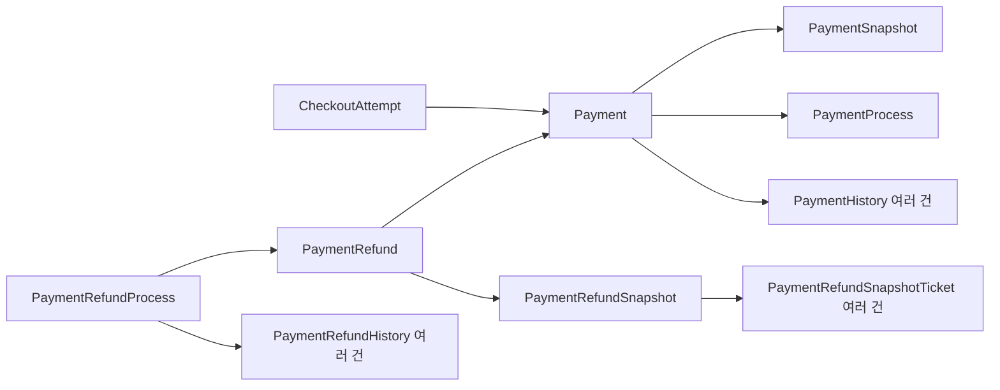

# 결제·환불 엔티티 구조

`CheckoutAttempt`는 결제 준비와 확정 요청의 멱등성을 관리하는 기존 구조를 유지한다. `CONFIRMED`는 실제 결제 완료가 아니라 예매와 결제 정보 생성의 확정을 뜻한다.

| 구분 | 현재 정보 | 확정된 계산 근거 | 최신 작업 단계 | 누적 사건 이력 |
| --- | --- | --- | --- | --- |
| 결제 | `Payment` | `PaymentSnapshot` | `PaymentProcess` | `PaymentHistory` |
| 환불 | `PaymentRefund` | `PaymentRefundSnapshot` | `PaymentRefundProcess` | `PaymentRefundHistory` |

`ticket-service`의 `jpa.payment` 아래 클래스는 역할별로 다음 패키지에 둔다.

| 패키지 | 포함 클래스 |
| --- | --- |
| `card` | `CardPaymentInfo` |
| `virtualAccount` | `VirtualAccountPaymentInfo` |
| `payment` | 결제 정보·스냅샷·프로세스·이력, 관련 저장소와 enum |
| `refund` | 환불 정보·스냅샷·프로세스·이력, 관련 저장소와 enum |

`service.payment`도 같은 하위 패키지 계층을 사용한다. `card`는 카드 승인, `virtualAccount`는 가상계좌 발급·입금·대사, `payment`는 공통 조회·완료·만료, `refund`는 카드·가상계좌 환불과 환불 프로세스를 담당한다. 대응하는 서비스 테스트도 같은 계층에 둔다.

## 결제

- `Payment`: 예매 참조, 결제번호·수단·업무 상태, 누적 환불액과 취소 수수료, 카드 승인 및 가상계좌 결과.
- `PaymentSnapshot`: 최종 결제액, 예매 수수료·배송비, 티켓별 가격과 적용 할인·쿠폰 정보. checkout 확정 시 생성하며 이후 변경하지 않는다. 티켓·할인 상세는 값 객체 컬렉션으로 저장한다.
- `PaymentProcess`: 승인 요청, 입금 대기, 로컬 완료 등 ticket-service가 확인한 최신 단계와 실패 원인·재시도 정보. PG 내부의 상태를 대신하는 엔티티는 아니다.
- `PaymentHistory`: 생성, 승인 요청·승인 반영, 완료, 실패, 만료, 결제 수단 변경, 환불·수수료 반영 등의 사건을 순서대로 누적한다. 사건 발생 시 결제 수단, 변경 전후 업무 상태, 누적 환불액과 수수료를 보관한다.

`Payment.status`는 업무 상태이고 `PaymentProcess.stage`는 작업 단계다. 예를 들어 승인 요청 중에는 업무 상태가 `READY`인 채 진행 단계만 `APPROVAL_REQUESTED`가 된다. 결제 이후 환불이 발생해도 결제 작업의 `LOCAL_COMPLETED` 단계는 유지하고 환불 작업은 별도 프로세스에서 관리한다.

## 환불

- `PaymentRefund`: 원본 결제 참조와 개별 환불의 업무 상태(`REQUESTED`, `COMPLETED`, 요청 변경으로 종료한 `SUPERSEDED`).
- `PaymentRefundSnapshot`: 요청 환불액, 취소 수수료, 전체 취소 여부, 대상 티켓과 당시 가격, 금액 계산 근거 및 마스킹한 환불 계좌. 계좌 원문 대신 비교용 SHA-256 해시를 저장한다.
- `PaymentRefundProcess`: 최신 PG/로컬 처리 단계, 실패 원인, 재시도 횟수와 처리 시각. 결제번호·수단·금액·예매 참조·티켓 ID 문자열을 별도 컬럼으로 반복 저장하지 않는다. 기존 조회 메서드는 환불 정보와 스냅샷을 참조하여 값을 반환한다.
- `PaymentRefundHistory`: 요청, 실패, 재시도, PG 성공, 로컬 반영과 완료의 사건을 누적한다. 요청 정보와 대상 티켓은 스냅샷에서 조회하고, 로컬 반영 성공 사건에만 처리 직후의 누적 환불액·환불 가능액·결제 상태를 기록한다.

기존 예매 상세 API의 `refundHistories`에는 `LOCAL_APPLIED` 성공 사건만 반환하여 응답 형태를 유지한다. 실패와 재시도 사건도 DB에는 남는다. `successKey`의 UNIQUE 제약으로 동일 프로세스의 로컬 성공 결과 중복 저장을 차단한다. 기존 `PaymentRefundHistoryTicket`는 `PaymentRefundSnapshotTicket`로 옮겼으며, common 응답도 `PaymentRefundSnapshotTicketResponse`와 `paymentRefundSnapshotTicketId`로 명칭을 맞춘다. DB 컬럼은 현재 테이블과 연결하기 위해 기존 `payment_refund_history_ticket_id` 매핑을 유지한다.

환불 프로세스는 PG 호출 전에 별도 트랜잭션으로 저장한다. 재시도는 같은 `paymentRefundProcessId`를 PG 멱등 키로 전달한다. 금액·티켓·계좌를 바꾸는 요청은 동일 환불 요청의 재시도로 처리하지 않는다. 완료된 프로세스는 뒤늦게 도착한 실패 기록으로 되돌리지 않는다.

신규 취소는 한국 시각으로 매일 23:50:00까지 허용하며, 이후부터 자정까지 신규 접수를 중단한다. 공연별 최종 마감이 더 이르면 그 시각을 적용한다. 기존 최종 마감이 23:50 이후인 경우 API 조회와 검증에서 같은 날짜의 23:50으로 제한한다.

`ReservationCancellationService.cancel()`은 기존 요청 조회·동일성 판단 → 결제 수단 분기 → 동일 요청 재개 또는 변경 요청 준비 순서로 실행한다. A는 `Reservation`의 비관적 잠금을 커밋·롤백까지 유지하며, 환불 프로세스는 일반 조회한다. 기존 요청이 없으면 생성 전용 B(`REQUIRES_NEW`)에서 프로세스·스냅샷을 커밋하고 A가 생성된 ID를 일반 조회한다. `inspectRequest()`와 `startGatewayAttempt()` 및 상태 변경은 모두 A에 참여한다. 입금 대기 예매에 기존 미완료 환불이 있는 상태 불일치도 거부한다.

환불 요청은 금액 계산보다 먼저 미완료 프로세스를 조회한다. 같은 결제·티켓 집합·전체 취소 여부·환불 계좌이면 저장된 환불액·수수료·쿠폰 복원 여부와 `capturedAt`을 사용하며, 현재 수수료나 신규 취소 기한으로 다시 검증하지 않는다. 티켓 ID 순서는 요청 동일성에 영향을 주지 않는다. 티켓 소유자와 현재 취소 가능 상태는 재시도에서도 검증한다.

요청을 변경할 때는 신규 마감 검증 후 PG의 내부 `resolve` API로 이전 요청을 확인한다. PG는 환불 실행과 같은 결제 행을 잠그고, 이미 성공했으면 `SUCCEEDED`, 미실행 요청을 종료했으면 `CLOSED`를 반환한다. 종료 기록은 늦게 도착한 이전 ID의 환불 실행을 차단한다. 단순한 환불 기록 부재 조회만으로는 새 요청을 허용하지 않는다. 성공이 확인되면 A에서 PG 성공 상태를 기록하고 기존 스냅샷으로 로컬 반영을 자동 완료한다. 이번 변경 요청은 추가로 실행하지 않는다. 취소 API는 `previousRequestRecovered`, 실제 처리한 `cancelledTicketIds`, 기존 `paymentRefundProcessId`와 안내 메시지를 반환하며 화면에도 처리된 좌석을 표시한다. 로컬 복구가 실패하면 A를 롤백하여 잠금을 해제한 뒤 별도 기록 트랜잭션에서 확인된 PG 성공과 로컬 실패를 보존한다. 기록이 유실되어도 기존 ID로 PG 결과를 조회하여 복구한다. 미실행 종료가 확인되면 A에서 이전 프로세스·환불을 `SUPERSEDED`로 닫고 B에서 새 요청을 저장한다. A가 롤백되면 PG 실행 차단이 확정된 이전 건의 종료 상태도 롤백 후 기록한다.

동일 요청의 PG 결과가 불명확하면 내부 조회로 성공 여부를 확인한 뒤, 미실행이면 기존 ID로 재시도한다. PG 종료 응답 유실이나 ticket DB 실패로 PG만 종료된 경우에도 종료 여부를 다시 확인하며, 동일 요청은 최초 조건을 새 ID로 복사해 복구한다. PG 조회·종료에 실패하거나 응답이 불일치하면 새 요청을 생성하지 않는다.

사용자·관리자 취소 진입점은 예매 잠금, 권한 검증과 감사 기록을 담당하며, 공통 `ReservationCancellationService`가 취소 절차를 수행한다. 공통 서비스는 `MANDATORY`로 호출자의 A 트랜잭션에 참여한다. 최초 스냅샷 생성 B와 롤백 후 결과 기록의 별도 트랜잭션은 유지한다.

환불 시도의 다음 행동은 `RefundAction`으로 표현한다. `REQUEST_GATEWAY`는 PG 환불 후 로컬 반영, `APPLY_LOCAL`은 PG 재호출 없이 로컬 반영, `RECOVER_PREVIOUS_REQUEST`는 기존 요청만 복구한다. 이 값은 저장되는 프로세스 상태와 구분된다.

로컬 취소를 마친 뒤 `completeCancellation`에서 환불 성공 이력과 완료 상태를 명시적으로 저장하고 최종 응답을 만든다. 완료 상태 변경을 커밋 콜백에 숨기지 않으며, 예매·티켓·결제 변경과 같은 A 트랜잭션에서 확정한다. 이후 커밋이 실패해도 로컬 변경과 성공 이력은 함께 롤백되고, 롤백 후 기록을 통해 PG 성공 건을 다시 복구할 수 있다. 입금 전 무통장 취소도 티켓·좌석 취소를 마친 뒤 응답한다.

사용자 취소·관리자 취소·관리자 수동 환불 완료는 모두 `Reservation` 행에 비관적 쓰기 잠금을 획득한 뒤 상태를 조회·검증한다. 잠금은 취소 요청의 바깥 트랜잭션이 커밋 또는 롤백할 때까지 유지한다. 생성 전용 B는 기존 예매·프로세스의 잠금을 다시 요청하지 않는다. A 실행 중에는 별도 트랜잭션에서 같은 프로세스를 갱신하지 않는다. 롤백 완료 후의 결과 기록도 예매만 잠근 뒤 프로세스를 일반 조회하며, 완료 상태나 더 최근 실패 기록을 덮어쓰지 않는다. 수동 완료는 프로세스에서 예매 ID만 먼저 조회하여 예매를 잠근 뒤 프로세스와 티켓을 불러온다.

외부 취소·수동 완료 요청의 예매 잠금에는 `NOWAIT`를 적용한다. 같은 예매가 처리 중이면 대기하지 않고 `409 Conflict`와 `RESERVATION_CANCELLATION_IN_PROGRESS`를 반환한다. 롤백 후 실패 기록은 잠금을 기다리는 기존 조회를 사용하여 이력 누락을 방지한다.

선택한 티켓 전체가 해당 예매와 예매 소유자에게 속해야 하며, 티켓은 결제 대기 또는 결제 완료, 좌석은 `LOCKED` 또는 `RESERVED` 상태여야 한다. 무통장 입금 전에는 전체 취소만 허용하고 부분 취소는 거부한다. 입금 완료 후에는 부분 취소를 허용한다. 수동 환불 완료는 PG 환불 성공을 전제로 결제 완료 티켓만 처리한다. 겹치는 티켓을 포함한 후속 요청은 앞 요청의 커밋 후 최신 상태를 검증하여 전체 거부하고, 남은 다른 티켓의 정상 부분 취소는 허용한다.

미결제 취소는 결제 수단이 무통장이고 결제 상태가 `WAITING_DEPOSIT`인 경우에만 허용한다. 남은 티켓 전체가 결제 대기 상태이고 예매가 결제 대기(`PENDING_PAYMENT`) 상태여야 하며, 전체 취소 여부와 신규 취소 마감도 검증한다. 카드 미결제와 결제 정보 누락은 거부한다. 결제 완료 티켓은 결제 정보가 반드시 존재하고 `PAID` 또는 `PARTIALLY_REFUNDED`여야 한다. 예매·티켓·결제 상태가 일치하지 않으면 로컬 취소 전에 중단한다.

## 저장 관계



예매·티켓·좌석·쿠폰·배송의 업무 엔티티는 유지한다. `ReservationDiscount`는 예매 할인과 쿠폰 복원에 계속 사용하며, 결제 확정 당시 그 내용을 `PaymentSnapshot`에도 고정한다. 기존 금액 계산 정책을 유지하고, 환불 티켓 응답 명칭은 새 스냅샷 엔티티에 맞춘다.

## 테이블 생성

결제·환불 테이블을 삭제하고 다시 만들 때는 `ticket-service/src/main/resources/sql/reset-payment-tables.sql`을 사용한다. 대상 데이터는 삭제되며, PG 멱등 키 충돌을 막기 위해 환불 프로세스 ID 시퀀스는 기존 값을 이어간다. 결제·입금 콜백·환불·관련 스케줄러의 쓰기를 중단한 상태에서 실행한다.

새 DB 전체를 초기화할 때는 `schema.sql`을 사용한다.

기존 ticket DB에는 새 스냅샷 필드를 추가한다. 기존 미완료 부분 환불의 쿠폰 복원 여부는 기존 할인 정책과 아직 취소되지 않은 티켓을 기준으로 초기화한다. 관련 쓰기를 중단한 상태에서 실행한다.

```sql
BEGIN;
ALTER TABLE payment_refund_snapshots
    ADD COLUMN IF NOT EXISTS restore_coupon BOOLEAN NOT NULL DEFAULT FALSE;
UPDATE payment_refund_snapshots s
SET restore_coupon = EXISTS (
    SELECT 1
    FROM payment_refunds r
    JOIN payment_refund_processes rp ON rp.refund_id = r.payment_refund_id
    JOIN payments p ON p.payment_id = r.payment_id
    JOIN reservation_discounts d ON d.reservation_id = p.reservation_id
    JOIN user_coupons uc ON uc.user_coupon_id = d.user_coupon_id
    JOIN coupons c ON c.coupon_id = uc.coupon_id
    WHERE r.refund_snapshot_id = s.payment_refund_snapshot_id
      AND rp.status IN ('REQUESTED', 'GATEWAY_FAILED', 'GATEWAY_SUCCEEDED', 'LOCAL_FAILED')
      AND NOT s.full_cancellation AND d.discount_amount > 0 AND uc.status = 'USED'
      AND c.min_order_amount IS NOT NULL
      AND (SELECT COALESCE(SUM(t.price), 0) FROM tickets t
           WHERE t.reservation_id = p.reservation_id AND t.status IN ('PAID', 'PENDING_PAYMENT'))
          - s.ticket_amount < c.min_order_amount
)
WHERE EXISTS (
    SELECT 1 FROM payment_refunds r
    JOIN payment_refund_processes rp ON rp.refund_id = r.payment_refund_id
    WHERE r.refund_snapshot_id = s.payment_refund_snapshot_id
      AND rp.status IN ('REQUESTED', 'GATEWAY_FAILED', 'GATEWAY_SUCCEEDED', 'LOCAL_FAILED')
);
COMMIT;
```

PG DB의 `gateway_refunds`는 `status`, `failure_reason`, `version`, `updated_at`을 사용한다. 기존 `closed` 컬럼의 상태를 변환하는 적용 SQL은 `docs/refund-idempotency.md`에 있다. 새 코드와 스키마는 ticket·PG를 함께 배포해야 한다.

기존 DB에 추가했던 중복 방지 컬럼은 아래 SQL로 제거한다. 해당 컬럼에 걸린 UNIQUE·CHECK·외래 키 제약도 PostgreSQL이 함께 제거한다. 관련 쓰기를 중단하고 새 코드 배포와 함께 적용한다.

```sql
BEGIN;
ALTER TABLE payment_refund_processes
    DROP COLUMN IF EXISTS active_payment_id;
COMMIT;
```

## 검증

`PaymentModelIntegrationTest`는 스냅샷 불변성, 단계와 이력의 분리, 실패·재시도 기록, 성공 이력 조회, 계좌 변경 거부, 트랜잭션 롤백, 완료 후 다음 부분 환불 허용을 H2에서 검증한다.

`ReservationCancellationConcurrencyTest`는 같은 예매의 동시 취소·수동 완료 요청이 첫 요청 종료 전에 거부되는지 H2에서 검증한다. 첫 요청 종료 후 최신 티켓 검증, 겹치지 않는 부분 취소, PG·로컬 실패 후 명시적인 재요청의 동일 프로세스 복구와 내부 기록의 대기형 잠금도 검증한다.
