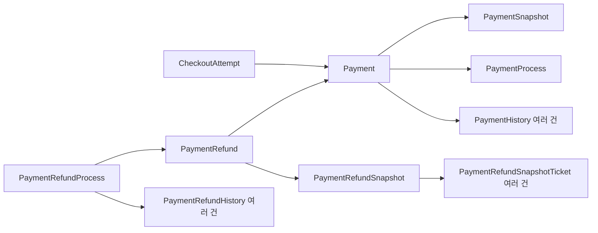

# 결제·환불 엔티티 구조

2026-11-12 신규 PG 무통장은 로컬 기한이 지나도 독자적으로 만료시키지 않는다. 은행 만료 Outbox를 반영한 PG의 EXPIRED 조회 결과로 기존 예매·티켓·좌석 정리를 수행한다. [만료 모델과 경합](payment-gateway-account-expiration.md)을 참고한다.

2026-11-12 발급 재시도 시각·전용 인덱스를 제거했다. 같은 요청 안에서 추가 3회만 재시도하며, 한도 소진 후에는 같은 checkout 키로 사용자가 재요청한다.

2026-11-11 Payment에 PG 거래 ID와 최초 은행·입금기한·미완료 발급 표시를 추가했다. 취소 Outbox의 전달 상태와 금융 결과를 구분한다. [Ticksy 신규 PG 연동·데이터 이전](ticksy-gateway-virtual-account.md)을 참고한다.

`CheckoutAttempt`는 결제 준비와 확정 요청의 멱등성을 관리하는 기존 구조를 유지한다. `CONFIRMED`는 실제 결제 완료가 아니라 예매와 결제 정보 생성의 확정을 뜻한다.

| 구분 | 현재 정보 | 확정된 계산 근거 | 최신 작업 단계 | 누적 사건 이력 |
| --- | --- | --- | --- | --- |
| 결제 | `Payment` | `PaymentSnapshot` | `PaymentProcess` | `PaymentHistory` |
| 환불 | `PaymentRefund` | `PaymentRefundSnapshot` | `PaymentRefundProcess` | `PaymentRefundHistory` |

`ticket-service`의 `jpa.payment` 아래 클래스는 역할별로 다음 패키지에 둔다.

| 패키지 | 포함 클래스 |
| --- | --- |
| `card` | `CardPaymentInfo` |
| `virtualAccount` | `VirtualAccountPaymentInfo` |
| `payment` | 결제 정보·스냅샷·프로세스·이력, 관련 저장소와 enum |
| `refund` | 환불 정보·스냅샷·프로세스·이력, 관련 저장소와 enum |

`service.payment`도 같은 하위 패키지 계층을 사용한다. `card`는 카드 승인, `virtualAccount`는 가상계좌 발급·입금·대사, `payment`는 공통 조회·완료·만료, `refund`는 카드·가상계좌 환불과 환불 프로세스를 담당한다. 대응하는 서비스 테스트도 같은 계층에 둔다.

## 결제

- `Payment`: 예매 참조, 결제번호·수단·업무 상태, 누적 환불액과 취소 수수료, 카드 승인 및 가상계좌 결과.
- `PaymentSnapshot`: 최종 결제액, 예매 수수료·배송비, 티켓별 가격과 적용 할인·쿠폰 정보. checkout 확정 시 생성하며 이후 변경하지 않는다. 티켓·할인 상세는 값 객체 컬렉션으로 저장한다.
- `PaymentProcess`: 승인 요청, 입금 대기, 로컬 완료 등 ticket-service가 확인한 최신 단계와 실패 원인·재시도 정보. PG 내부의 상태를 대신하는 엔티티는 아니다.
- `PaymentHistory`: 생성, 승인 요청·승인 반영, 완료, 실패, 만료, 결제 수단 변경, 환불·수수료 반영 등의 사건을 순서대로 누적한다. 사건 발생 시 결제 수단, 변경 전후 업무 상태, 누적 환불액과 수수료를 보관한다.

`Payment.status`는 업무 상태이고 `PaymentProcess.stage`는 작업 단계다. 예를 들어 승인 요청 중에는 업무 상태가 `READY`인 채 진행 단계만 `APPROVAL_REQUESTED`가 된다. 결제 이후 환불이 발생해도 결제 작업의 `LOCAL_COMPLETED` 단계는 유지하고 환불 작업은 별도 프로세스에서 관리한다.

## 환불

- `PaymentRefund`: 원본 결제 참조와 개별 환불의 업무 상태(`REQUESTED`, `COMPLETED`, 요청 변경으로 종료한 `SUPERSEDED`).
- `PaymentRefundSnapshot`: 요청 환불액, 취소 수수료, 전체 취소 여부, 대상 티켓과 당시 가격, 금액 계산 근거 및 마스킹한 환불 계좌. 계좌 원문 대신 비교용 SHA-256 해시를 저장한다.
- `PaymentRefundProcess`: 최신 PG/로컬 처리 단계, 실패 원인, 재시도 횟수와 처리 시각. 결제번호·수단·금액·예매 참조·티켓 ID 문자열을 별도 컬럼으로 반복 저장하지 않는다. 기존 조회 메서드는 환불 정보와 스냅샷을 참조하여 값을 반환한다.
- `PaymentRefundHistory`: 요청, 실패, 재시도, PG 성공, 로컬 반영과 완료의 사건을 누적한다. 요청 정보와 대상 티켓은 스냅샷에서 조회하고, 로컬 반영 성공 사건에만 처리 직후의 누적 환불액·환불 가능액·결제 상태를 기록한다.

기존 예매 상세 API의 `refundHistories`에는 `LOCAL_APPLIED` 성공 사건만 반환하여 응답 형태를 유지한다. 실패와 재시도 사건도 DB에는 남는다. `successKey`의 UNIQUE 제약으로 동일 프로세스의 로컬 성공 결과 중복 저장을 차단한다. 기존 `PaymentRefundHistoryTicket`는 `PaymentRefundSnapshotTicket`로 옮겼으며, common 응답도 `PaymentRefundSnapshotTicketResponse`와 `paymentRefundSnapshotTicketId`로 명칭을 맞춘다. DB 컬럼은 현재 테이블과 연결하기 위해 기존 `payment_refund_history_ticket_id` 매핑을 유지한다.

환불 프로세스는 PG 호출 전에 별도 트랜잭션으로 저장한다. 재시도는 같은 `paymentRefundProcessId`를 PG 멱등 키로 전달한다. 금액·티켓·계좌를 바꾸는 요청은 동일 환불 요청의 재시도로 처리하지 않는다. 완료된 프로세스는 뒤늦게 도착한 실패 기록으로 되돌리지 않는다.

신규 취소는 한국 시각으로 매일 23:50:00까지 허용하며, 이후부터 자정까지 신규 접수를 중단한다. 공연별 최종 마감이 더 이르면 그 시각을 적용한다. 기존 최종 마감이 23:50 이후인 경우 API 조회와 검증에서 같은 날짜의 23:50으로 제한한다.

현재 환불 실행 진입점은 `ReservationRefundController` → `ReservationRefundService` → `ReservationRefundCommandService`다. 최초 신청은 예매·선택 티켓·금액·계좌 스냅샷과 프로세스 ID를 먼저 커밋한다. 재시도는 같은 ID와 최초 스냅샷을 사용하며, 진행 중인 신청과 다른 요청은 거절한다. 신청 철회는 PG와 금융 도메인에서 미실행 종료 또는 이미 성공한 결과를 확인한 뒤 반영한다. 자동으로 다른 요청으로 대체하지 않는다.

실행·재시도·철회는 Reservation의 FOR UPDATE NOWAIT 잠금으로 충돌을 거절한다. Ticksy → PG는 한 번 호출하고, PG → 은행·카드는 같은 작업 키로 최대 네 번 시도한다. 외부 HTTP와 로컬 DB의 원자성을 가정하지 않으며, 응답 유실 시 같은 프로세스 ID로 결과를 복구한다.

신규 환불의 로컬 완료는 PaymentRefundProcessService.completeLocal을 사용한다. PG 성공을 확인한 뒤 예매·티켓·좌석·결제·쿠폰과 LOCAL_APPLIED 이력을 같은 로컬 트랜잭션에 반영한다. 이 로컬 반영이 실패하면 전체 롤백하고 별도 실패 기록을 남긴다. 관리자 로컬 수동 완료와 감사 기록도 유지한다.

ReservationCancellationService는 입금 전 무통장의 전체 취소만 담당한다. 예매·티켓·Payment 취소, 좌석 AVAILABLE 복원, PG 취소 Outbox 저장을 함께 커밋한다. 결제된 예매는 신규 환불 신청 API를 안내하며 구형 카드·계좌 환불을 실행하지 않는다. 진행 중인 환불 존재 여부는 hasUnfinishedRequest로 읽기만 한다.

구형 inspectRequest/startGatewayAttempt/resolve 기반 재시도·자동 대체 흐름과 전용 클라이언트는 제거했다. SUPERSEDED 등 과거 상태와 이력 테이블은 스키마 호환을 위해 유지하며 신규 환불은 해당 대체 흐름을 생성하지 않는다. 자세한 변경 범위는 [레거시 정리 기록](payment-legacy-retirement.md), 현행 금융 계약은 [카드 환불](payment-gateway-card-refund.md)·[은행 환불](payment-gateway-bank-refund.md)을 참고한다.

## 저장 관계



예매·티켓·좌석·쿠폰·배송의 업무 엔티티는 유지한다. `ReservationDiscount`는 예매 할인과 쿠폰 복원에 계속 사용하며, 결제 확정 당시 그 내용을 `PaymentSnapshot`에도 고정한다. 기존 금액 계산 정책을 유지하고, 환불 티켓 응답 명칭은 새 스냅샷 엔티티에 맞춘다.

## 테이블 생성

결제·환불 테이블을 포함한 테이블 정의는 `ticket-service/src/main/resources/sql/schema.sql`에서 관리한다.

기존 ticket DB에는 새 스냅샷 필드를 추가한다. 기존 미완료 부분 환불의 쿠폰 복원 여부는 기존 할인 정책과 아직 취소되지 않은 티켓을 기준으로 초기화한다. 관련 쓰기를 중단한 상태에서 실행한다.

```sql
BEGIN;
ALTER TABLE payment_refund_snapshots
    ADD COLUMN IF NOT EXISTS restore_coupon BOOLEAN NOT NULL DEFAULT FALSE;
UPDATE payment_refund_snapshots s
SET restore_coupon = EXISTS (
    SELECT 1
    FROM payment_refunds r
    JOIN payment_refund_processes rp ON rp.refund_id = r.payment_refund_id
    JOIN payments p ON p.payment_id = r.payment_id
    JOIN reservation_discounts d ON d.reservation_id = p.reservation_id
    JOIN user_coupons uc ON uc.user_coupon_id = d.user_coupon_id
    JOIN coupons c ON c.coupon_id = uc.coupon_id
    WHERE r.refund_snapshot_id = s.payment_refund_snapshot_id
      AND rp.status IN ('REQUESTED', 'GATEWAY_FAILED', 'GATEWAY_SUCCEEDED', 'LOCAL_FAILED')
      AND NOT s.full_cancellation AND d.discount_amount > 0 AND uc.status = 'USED'
      AND c.min_order_amount IS NOT NULL
      AND (SELECT COALESCE(SUM(t.price), 0) FROM tickets t
           WHERE t.reservation_id = p.reservation_id AND t.status IN ('PAID', 'PENDING_PAYMENT'))
          - s.ticket_amount < c.min_order_amount
)
WHERE EXISTS (
    SELECT 1 FROM payment_refunds r
    JOIN payment_refund_processes rp ON rp.refund_id = r.payment_refund_id
    WHERE r.refund_snapshot_id = s.payment_refund_snapshot_id
      AND rp.status IN ('REQUESTED', 'GATEWAY_FAILED', 'GATEWAY_SUCCEEDED', 'LOCAL_FAILED')
);
COMMIT;
```

PG DB의 `gateway_refunds`는 `status`, `failure_reason`, `version`, `updated_at`을 사용한다. 기존 `closed` 컬럼의 상태를 변환하는 적용 SQL은 `docs/refund-idempotency.md`에 있다. 새 코드와 스키마는 ticket·PG를 함께 배포해야 한다.

기존 DB에 추가했던 중복 방지 컬럼은 아래 SQL로 제거한다. 해당 컬럼에 걸린 UNIQUE·CHECK·외래 키 제약도 PostgreSQL이 함께 제거한다. 관련 쓰기를 중단하고 새 코드 배포와 함께 적용한다.

```sql
BEGIN;
ALTER TABLE payment_refund_processes
    DROP COLUMN IF EXISTS active_payment_id;
COMMIT;
```

## 검증

`PaymentModelIntegrationTest`는 스냅샷 불변성, 단계와 이력의 분리, 실패·재시도 기록, 성공 이력 조회, 계좌 변경 거부, 트랜잭션 롤백, 완료 후 다음 부분 환불 허용을 H2에서 검증한다.

`ReservationCancellationConcurrencyTest`는 같은 예매의 동시 취소·수동 완료 요청이 첫 요청 종료 전에 거부되는지 H2에서 검증한다. 첫 요청 종료 후 최신 티켓 검증, 겹치지 않는 부분 취소, PG·로컬 실패 후 명시적인 재요청의 동일 프로세스 복구와 내부 기록의 대기형 잠금도 검증한다.
