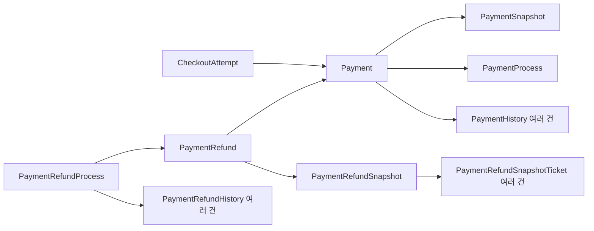

# 결제·환불 엔티티 구조

`CheckoutAttempt`는 결제 준비와 확정 요청의 멱등성을 관리하는 기존 구조를 유지한다. `CONFIRMED`는 실제 결제 완료가 아니라 예매와 결제 정보 생성의 확정을 뜻한다.

| 구분 | 현재 정보 | 확정된 계산 근거 | 최신 작업 단계 | 누적 사건 이력 |
| --- | --- | --- | --- | --- |
| 결제 | `Payment` | `PaymentSnapshot` | `PaymentProcess` | `PaymentHistory` |
| 환불 | `PaymentRefund` | `PaymentRefundSnapshot` | `PaymentRefundProcess` | `PaymentRefundHistory` |

`ticket-service`의 `jpa.payment` 아래 클래스는 역할별로 다음 패키지에 둔다.

| 패키지 | 포함 클래스 |
| --- | --- |
| `card` | `CardPaymentInfo` |
| `virtualAccount` | `VirtualAccountPaymentInfo` |
| `payment` | 결제 정보·스냅샷·프로세스·이력, 관련 저장소와 enum |
| `refund` | 환불 정보·스냅샷·프로세스·이력, 관련 저장소와 enum |

## 결제

- `Payment`: 예매 참조, 결제번호·수단·업무 상태, 누적 환불액과 취소 수수료, 카드 승인 및 가상계좌 결과.
- `PaymentSnapshot`: 최종 결제액, 예매 수수료·배송비, 티켓별 가격과 적용 할인·쿠폰 정보. checkout 확정 시 생성하며 이후 변경하지 않는다. 티켓·할인 상세는 값 객체 컬렉션으로 저장한다.
- `PaymentProcess`: 승인 요청, 입금 대기, 로컬 완료 등 ticket-service가 확인한 최신 단계와 실패 원인·재시도 정보. PG 내부의 상태를 대신하는 엔티티는 아니다.
- `PaymentHistory`: 생성, 승인 요청·승인 반영, 완료, 실패, 만료, 결제 수단 변경, 환불·수수료 반영 등의 사건을 순서대로 누적한다. 사건 발생 시 결제 수단, 변경 전후 업무 상태, 누적 환불액과 수수료를 보관한다.

`Payment.status`는 업무 상태이고 `PaymentProcess.stage`는 작업 단계다. 예를 들어 승인 요청 중에는 업무 상태가 `READY`인 채 진행 단계만 `APPROVAL_REQUESTED`가 된다. 결제 이후 환불이 발생해도 결제 작업의 `LOCAL_COMPLETED` 단계는 유지하고 환불 작업은 별도 프로세스에서 관리한다.

## 환불

- `PaymentRefund`: 원본 결제 참조와 개별 환불의 업무 상태(`REQUESTED`, `COMPLETED`).
- `PaymentRefundSnapshot`: 요청 환불액, 취소 수수료, 전체 취소 여부, 대상 티켓과 당시 가격, 금액 계산 근거 및 마스킹한 환불 계좌. 계좌 원문 대신 비교용 SHA-256 해시를 저장한다.
- `PaymentRefundProcess`: 최신 PG/로컬 처리 단계, 실패 원인, 재시도 횟수와 처리 시각. 결제번호·수단·금액·예매 참조·티켓 ID 문자열을 별도 컬럼으로 반복 저장하지 않는다. 기존 조회 메서드는 환불 정보와 스냅샷을 참조하여 값을 반환한다.
- `PaymentRefundHistory`: 요청, 실패, 재시도, PG 성공, 로컬 반영과 완료의 사건을 누적한다. 요청 정보와 대상 티켓은 스냅샷에서 조회하고, 로컬 반영 성공 사건에만 처리 직후의 누적 환불액·환불 가능액·결제 상태를 기록한다.

기존 예매 상세 API의 `refundHistories`에는 `LOCAL_APPLIED` 성공 사건만 반환하여 응답 형태를 유지한다. 실패와 재시도 사건도 DB에는 남는다. `successKey`의 UNIQUE 제약으로 동일 프로세스의 로컬 성공 결과 중복 저장을 차단한다. 기존 `PaymentRefundHistoryTicket`는 `PaymentRefundSnapshotTicket`로 옮겼으며, common 응답도 `PaymentRefundSnapshotTicketResponse`와 `paymentRefundSnapshotTicketId`로 명칭을 맞춘다. DB 컬럼은 현재 테이블과 연결하기 위해 기존 `payment_refund_history_ticket_id` 매핑을 유지한다.

환불 프로세스는 PG 호출 전에 별도 트랜잭션으로 저장한다. 재시도는 같은 `paymentRefundProcessId`를 PG 멱등 키로 전달한다. 금액·티켓·계좌를 바꾸는 요청은 동일 환불 요청의 재시도로 처리하지 않는다. 완료된 프로세스는 뒤늦게 도착한 실패 기록으로 되돌리지 않는다.

로컬 환불 성공 이력, 환불 업무 완료 상태와 프로세스 완료 상태는 예매·티켓·결제 변경과 같은 트랜잭션에 저장한다. 커밋 직후 별도 완료 표시를 하기 전에 프로세스가 종료되어도 성공 상태가 누락되지 않는다.

진행 중인 환불 프로세스는 `active_payment_id`에 원본 결제 ID를 저장하며, `uk_refund_process_active_payment` UNIQUE 제약으로 같은 결제의 최초 동시 환불 생성을 차단한다. 생성 시 즉시 flush하여 중복 요청이 PG 호출까지 진행하지 않도록 한다. PG 또는 로컬 실패 시 키를 유지하고, `LOCAL_SUCCEEDED` 반영과 같은 트랜잭션에서 키를 NULL로 해제하여 다음 부분 환불을 허용한다. CHECK 제약은 진행 중인 프로세스의 키 누락을 막는다.

## 저장 관계



예매·티켓·좌석·쿠폰·배송의 업무 엔티티는 유지한다. `ReservationDiscount`는 예매 할인과 쿠폰 복원에 계속 사용하며, 결제 확정 당시 그 내용을 `PaymentSnapshot`에도 고정한다. 기존 금액 계산 정책을 유지하고, 환불 티켓 응답 명칭은 새 스냅샷 엔티티에 맞춘다.

## 테이블 생성

결제·환불 테이블을 삭제하고 다시 만들 때는 `ticket-service/src/main/resources/sql/reset-payment-tables.sql`을 사용한다. 대상 데이터는 삭제되며, PG 멱등 키 충돌을 막기 위해 환불 프로세스 ID 시퀀스는 기존 값을 이어간다. 결제·입금 콜백·환불·관련 스케줄러의 쓰기를 중단한 상태에서 실행한다.

새 DB 전체를 초기화할 때는 `schema.sql`을 사용한다.

기존 데이터를 유지하면서 제약을 추가할 경우, 관련 쓰기를 중단하고 아래 SQL을 실행한다. 같은 결제에 진행 중인 프로세스가 이미 여러 개 있으면 UNIQUE 추가가 실패하여 전체 변경이 롤백된다. 그런 경우 PG 이력을 확인하여 중복 프로세스를 먼저 정리해야 한다.

```sql
BEGIN;
ALTER TABLE payment_refund_processes
    ADD COLUMN active_payment_id BIGINT REFERENCES payments(payment_id);
UPDATE payment_refund_processes p
SET active_payment_id = r.payment_id
FROM payment_refunds r
WHERE p.refund_id = r.payment_refund_id
    AND p.status <> 'LOCAL_SUCCEEDED';
ALTER TABLE payment_refund_processes
    ADD CONSTRAINT uk_refund_process_active_payment UNIQUE (active_payment_id),
    ADD CONSTRAINT ck_refund_process_active_payment CHECK (
        (status = 'LOCAL_SUCCEEDED' AND active_payment_id IS NULL)
        OR (status <> 'LOCAL_SUCCEEDED' AND active_payment_id IS NOT NULL)
    );
COMMIT;
```

## 검증

`PaymentModelIntegrationTest`는 스냅샷 불변성, 단계와 이력의 분리, 실패·재시도 기록, 성공 이력 조회, 계좌 변경 거부, 트랜잭션 롤백, 최초 동시 환불 생성 차단, 완료 후 다음 부분 환불 허용을 H2에서 검증한다.
